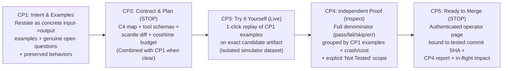
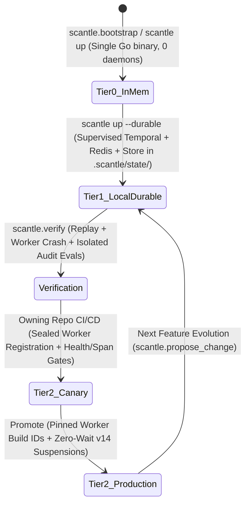
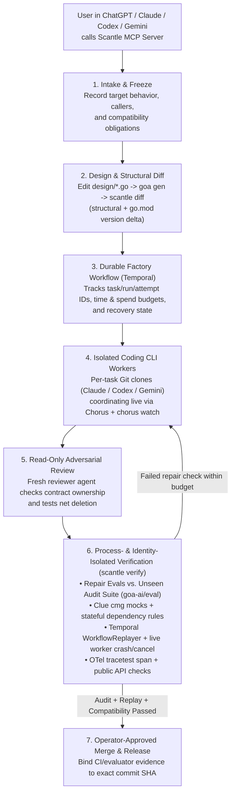

# Scantle: The MCP-Native Software Factory for Agentic Platforms on the Goa Design Suite

*Architecture and product proposal for Scantle (`goa`, `goa-ai`, `pulse`, `clue`, `model`, and `chorus`). A **scantle** is a slater’s gauge rod, marked with slate lengths and spacing so every slate is measured against it: Scantle uses one `design/*.go` contract for the interfaces and generated plumbing that every builder works to, while independent checks verify the resulting behavior.*

---

## 0. Who Scantle Is For (and Not For)

Scantle is built for teams that own an evolving agentic service in production—especially workflows that take real, side-effecting actions (issuing refunds, modifying orders, controlling equipment, changing cloud configuration) or long-running cross-service assistants with strict authorization, cost, and audit requirements.

| Persona | Layer 1 (Intent, Examples & Sandbox) | Layer 2 (Contracts, Diffs & Evidence) | Layer 3 (Traces, Replay & Go Code) |
| :--- | :--- | :--- | :--- |
| **Product / Domain Owner** *(PM, Ops Lead, Support Lead, Risk Analyst)* | **CP1** examples & open questions, **CP3** sandbox playground, **CP4** summary | Rarely (`CP2` summary sentence) | Never |
| **Owning Backend / Platform Engineer** *(Beachhead User & Champion)* | **CP2** scope summary | **C4 Map**, tool contract cards, `scantle diff`, **CP4** check breakdown | OTel traces, Temporal replay, Go domain code |
| **Engineering Leader** *(VP Eng, Head of Platform, CTO)* | **CP4** & **CP5** history across changes, cost & token budget per change | None | None |
| **Security, Compliance & Risk** | **CP5** authenticated approval records | **CP4** independent evidence & `"Not Tested"` scope | Trace and artifact links on request |

- **Practical Adoption Readiness (First Design-Partner Hypothesis):** Existing **Go and Goa teams** are the natural first design partners because their contracts and toolchain already match, followed by polyglot platform teams moving brittle agent prototypes into production. Adoption can start with **a single generated Go agent service calling existing Python, TypeScript, or Java services** over HTTP, gRPC, or MCP—no backend-wide rewrite required.
- **Who Scantle Is Not For:**
  1. **Disposable chat demos or one-off prompt experiments** with no long-term operational ownership (a notebook or lightweight SDK is faster).
  2. **Teams where nobody will own or debug a generated Go service in production** (PMs never touch Go, and `goa gen` writes the transport/MCP/workflow plumbing, but an engineer still operates and debugs the Go service).
  3. **Teams seeking a "zero-human" factory** with no human review of intent (`CP1`/`CP2`) or merges (`CP5`).
  4. **Ordinary CRUD web apps or static sites** without agentic workflows (use standard `goa` or a template portal directly).

---

## 1. User Experience: An MCP-First Factory Inside Your Favorite AI Assistant

Engineering teams do not want to learn another proprietary IDE or wrestle with a complex CLI just to build an agentic platform. **Scantle’s primary interface is a Model Context Protocol (MCP `2026-07-28`) server.** Engineers and product owners use the AI assistant they already work in—**ChatGPT, Claude, Codex, Gemini, or Cursor**—connected to the `scantle` MCP server to bootstrap, edit, verify, and release their platform through natural conversation, asynchronous MCP tasks, and interactive **MCP Apps**.

Applying **Google UX principles**—*focus on the user's outcome, one unmistakable primary action per step, progressive disclosure of complexity, and forgiving error states*—Scantle hides distributed-systems machinery by default while keeping every contract, trace span, and workflow replay one click or prompt away.

### Progressive Disclosure Across Three Layers (MCP Tools, Tasks, Resources & Apps)

Scantle is itself a Goa-AI MCP server (`MCP("scantle", "1.0.0")`) that uses standard MCP capabilities with fallbacks so every MCP client works out of the box:
1. **Non-Blocking Start Tools + Optional MCP Tasks (`TaskExchange`):** Because Goa-AI's `TaskExchange` creator requires the client to advertise MCP task support before executing, every long-running factory operation (`scantle.bootstrap`, `scantle.propose_change`, `scantle.verify`, and `scantle.merge`) is an ordinary MCP tool that starts the server-owned Temporal workflow and immediately returns its stable `run_id` to *any* MCP host. Hosts can then query `scantle.status(run_id)` or read `scantle://runs/<run_id>` at any time (even after closing and reopening their chat client the next day), while task-capable MCP hosts can also track the same run via MCP Tasks (`tasks/get`—which delivers final results—`tasks/update`, and `tasks/cancel` in [`runtime/mcp/tasks.go`](https://github.com/goadesign/goa-ai/blob/99d852887d117be5878b167645a1114d83031147/runtime/mcp/tasks.go)).
2. **Subscribed MCP Resources (`Resource` & `SubscriptionSource`):** Live build progress, C4 architecture diagrams, structural diffs, and evaluation reports publish `notifications/resources/updated` events for subscribing hosts, while remaining readable on demand via `resources/read` or `scantle.status`.
3. **Interactive MCP Apps (`dsl/mcp_apps.go`) with Plain-Text Fallback & Explicit Connectivity:**

| Host Environment | Connectivity to Scantle MCP | How Scantle Renders Cards, C4 Maps & Playgrounds | How Operator Approvals & Notifications Work |
| :--- | :--- | :--- | :--- |
| **Local MCP Clients** *(Claude Code, Codex CLI, Cursor, Claude Desktop, local Gemini CLI)* | Connects directly to local `http://localhost:<port>/mcp` after `scantle up` runs a single preflight check (`go`, `git`, `redis-server`, `temporal`, coding CLIs, and optional LLM API key). | Renders interactive HTML cards inline when the host supports MCP Apps, or returns Markdown summary cards with `http://localhost:9400/runs/<id>` links to the local Scantle Studio web view. | Returns a signed approval URL (bound to the Change Card digest and commit SHA) that opens in the operator's browser and requires an authenticated, authorized human operator session—so a model cannot self-approve by visiting or echoing a URL. Supports desktop/Slack notifications when a run reaches `CP3`/`CP4` or hits an open question. |
| **Cloud-Hosted Web Chat Clients** *(e.g. ChatGPT web, Claude web)* | Connects to a **Team-Hosted HTTPS Scantle MCP Endpoint** (with OAuth/OIDC identity) or a `scantle up --tunnel` endpoint (`https://...`). | Renders MCP App cards inline when supported, or structured Markdown summaries + status tool queries (`scantle.status`). | Returns a signed approval URL bound to the Change Card digest and commit SHA that requires an authenticated, authorized human operator session at Scantle's web boundary, plus optional Slack/email notifications when async runs finish. |

| Disclosure Layer | How the User Accesses It | What the User Sees | What Stays Hidden Until Requested |
| :--- | :--- | :--- | :--- |
| **Layer 1: Conversational Intent & Summary Cards (Default)** | Natural-language prompts in ChatGPT, Claude, Codex, or Gemini (`scantle.bootstrap`, `scantle.propose_change`). | Plain-English **Confidence Checkpoints (`CP1`–`CP5`)**, live **C4 Architecture Map** (`model`), an **Agent Playground** to interact with the candidate build, pass/fail verification summaries, and **one primary action**. | Generated `gen/` Go files, raw JSON Schemas, workflow queue names, and container logs. |
| **Layer 2: Contracts, Structural Diffs & Tool Trajectories (1 Click / Prompt Deeper)** | Clicking **"View Contract & Diff"** or calling `scantle.inspect(target: "diff" \| "trajectory")`. | The Goa/Goa-AI `design/*.go` contract, structural and version diff report (`scantle diff`), and the recorded sequence of agent tool calls and arguments (`eval/evidence`). | Wire-protocol framing, compiler AST internals, and raw database state. |
| **Layer 3: Deep Systems, Trace Waterfalls & Replay Internals (On-Demand)** | Clicking a failed check or calling `scantle.inspect(target: "trace" \| "replay")`. | Clue/OpenTelemetry span waterfalls (`gen_ai.agent.run` -> `gen_ai.execute_tool`), Temporal workflow replay histories, and the Chorus `#scantle` multi-agent build transcript. | Nothing—full glass-box visibility into every underlying primitive. |

**Presentation Boundary (MCP Apps + Optional Replaceable OpenUI Starter):** Scantle's fixed control-plane cards (**CP1**–**CP5**) are **authored React components** over generated Goa types and authoritative evidence IDs (`run_id`, `check_id`, `span_id`), rendered inside MCP Apps ([`ToolUI`](https://github.com/goadesign/goa-ai/blob/99d852887d117be5878b167645a1114d83031147/dsl/mcp_apps.go#L15) + [`ToolVisibility`](https://github.com/goadesign/goa-ai/blob/99d852887d117be5878b167645a1114d83031147/dsl/mcp_apps.go#L31)) and local Scantle Studio with an identical-fact plain-text fallback (never applying [`RequiresUI`](https://github.com/goadesign/goa-ai/blob/99d852887d117be5878b167645a1114d83031147/dsl/presentation.go#L12) to essential factory or domain tools that must also work in text-only hosts). During development (**CP3**), the sandbox acts as a standard **MCP Apps host**: whenever a target service's MCP tools declare `ToolUI` (`ui://` HTML resources), `CP3` renders those target UIs live alongside the raw structured tool results and [`ServerData`](https://github.com/goadesign/goa-ai/blob/99d852887d117be5878b167645a1114d83031147/dsl/tool.go#L273) payloads—regardless of what UI library the team uses, keeping `goa`, `goa-ai`, and `scantle` core completely UI-agnostic. For teams that want rich generative UI in their target platform without building a frontend from scratch (or for open-ended Layer 2–3 diagnostic views), Scantle provides an **opt-in, replaceable, target-owned OpenUI viewer starter** ([`thesysdev/openui`](https://github.com/thesysdev/openui), MIT-licensed, where the team's chosen OpenUI component library [`defineComponent`](https://www.openui.com/docs/openui-lang/defining-components) generates its own catalog prompt once for the composition call, rather than inferring components from domain schemas or repeating catalogs in per-tool [`UIInstructions`](https://github.com/goadesign/goa-ai/blob/99d852887d117be5878b167645a1114d83031147/dsl/presentation.go#L34)) plus an optional target-owned OpenUI parser/catalog check in `scantle.verify`, under two strict contracts:
1. **Completed-Composition Integrity vs. Authoritative Qualifications:** Because OpenUI’s renderer can omit invalid children or unresolved references and discard extra arguments ([renderer contract](https://www.openui.com/docs/openui-lang/renderer)), the viewer and optional target verifier step use OpenUI's own parser/error APIs (returning ordinary `eval.Check`/`Artifact` results without reimplementing the parser in Go) to verify **component, argument, and reference integrity**—distinguishing partial streaming from a completed invalid composition and rejecting any completed program that drops components, arguments, or references. Because a syntactically valid program could still omit caveats without a parser error (and headless parsing alone does not prove browser rendering), required source, scope, and `"Not Tested"` coverage qualifications are enforced directly by authored evidence components or the surrounding viewer from authoritative data, and any display failure surfaces an explicit error while preserving the raw structured/text evidence.
2. **Operation & Approval Boundary:** OpenUI `Query`/`Mutation` bindings (`toolProvider`) are restricted to the target viewer's explicitly opted-in typed operations with server-side authentication and authorization at the owning service API ([operations contract](https://www.openui.com/docs/openui-lang/queries-mutations)), and composition-requested operation dispatch is enabled **only after completed-composition validation succeeds** (so an incomplete or invalid composition with dropped sibling components can never initiate new operations when streaming ends); the viewer loads saved domain/evidence records by ID rather than inventing status, any model-generated composition call is explicitly identified and accounted for in token budgets, and authenticated human approval controls (**CP2** and **CP5**) remain strictly application-owned outside model or target-UI control.

### The Five User-Confidence Checkpoints (Single Source of Truth for the User Journey)

A user’s confidence rests on one unbroken chain they can follow: **their own words -> concrete examples -> compiled contract -> live sandbox -> independent verification evidence**. Never show a vague `"100% Correct"` badge; show what was checked, who checked it, and what was *not* checked. Checkpoints are visible confidence states rather than unnecessary extra consent clicks: **when a request has no unresolved questions, `CP1` and `CP2` combine into a single approval screen**, and a clear, already-authorized small change proceeds without a clarification stop.

| Checkpoint | Stop or Non-Blocking? | What the User Sees & Does (Layer 1 -> Layer 2 -> Layer 3) | Provable System Truth Backing the Card |
| :--- | :--- | :--- | :--- |
| **CP1: "Here’s What I Understood"** *(Intent & Concrete Examples)* | **STOP only when open questions exist** *(Combined with `CP2` when intent is already clear)* | Scantle restates the request as **concrete input -> outcome examples with real values** (e.g., for *"refunds under \$50 get instant credit, larger ones wait for a manager"*: `\$38.50 total -> instant credit [deterministic]`; `\$82.00 total -> manager approval [deterministic]`; `manager declines -> customer explanation [model-judged]`), asks **genuinely unresolved questions** (*"Is 'under \$50' item subtotal or total with tax & shipping—e.g. \$48 item + \$6 shipping = \$54? And what about exactly \$50.00?"*), and lists **preserved behaviors**. | Saves the original request, confirmed examples, unresolved questions, and preserved behaviors as a versioned request. An **isolated evaluator-side authoring agent** translates confirmed examples into executable `goa-ai/eval` scenario `Hooks` and `clue/mock` stateful simulator callbacks, explicitly labeled `deterministic check`, `model-judged claim`, or `not yet implemented`. |
| **CP2: "Here’s How It Will Work"** *(Contract & Impact Card)* | **STOP** *(Authenticated Approve & Build)* | **L1:** Plain-English scope (*"1 service, 1 agent, 1 human approval step; est. ~4 min / \$0.40 budget; 10 checks planned"*), **proposed Chorus swarm roster** (`@architect`, `@builder-<scope>`, `@eval-author`, `@reviewer` with `cross_family_review` / `cross_family_eval` status), and a **deterministic plain-English capability summary** (`Declared Tools`, `Server-Supplied Inputs`, `Confirmation Configured`, `Bounded Result Declared`, `Cache Hints Configured`). **L2:** Highlighted **C4 Map** (`model`) + tool cards showing what the agent can call and what identity fields (`Inject`/`BindField`) are server-supplied, plus the pinned Chorus Collaboration Manifest. **L3:** `design/*.go` + `scantle diff`. | Renders the capability summary deterministically from `goa-ai`'s generated tool specs, schemas, and agent docs (never claiming runtime isolation that static declarations alone cannot prove), alongside the compiled `eval.RunDSL` design, `scantle diff`, `plugins/model` C4 container map, and `internal/swarm` role/model routing plan for the exact request revision and base commit. |
| **CP3: "Try It Yourself"** *(Live Sandbox Playground & Fast Draft Loop)* | **Non-Blocking** *(Available once repair checks pass)* | Interactive playground where **each CP1 example is a 1-click replay button**, plus free-form chat input (with live LLM reasoning or an explicit **`Scripted Smoke Demo — No Live LLM`** badge when no model key is configured), live **MCP Apps hosting** (rendering any target `ToolUI` `ui://` resource—including the optional target-owned **OpenUI** viewer starter—next to a raw `Result`/`ServerData` JSON toggle), a **Role Switcher** (`Customer` vs. `Approving Manager` to approve/decline suspended runs), **`[+ Make This an Example]`** on any turn to turn a real conversation into a regression test, **Fast Draft Mode** for rapid prompt/threshold tweaks, and an explicit **Environment Profile banner** (`sim`: *"Simulated payment system (v1.2): no real money moves"* vs. `staging`: *"Staging payment sandbox: real staging API Calls on disposable test data"*). | Boots the **exact candidate artifact and resolved prompt/runtime config** identified in `CP4`. The candidate's `cmd/<service>/main.go` selects only the dependency endpoint URL (`sim` vs. `staging`) behind the **same generated client boundary**; in `sim`, simulator API handlers, `clue/mock` `Mock.Set` callbacks, and ledger state run in the **evaluator-controlled process** (outside candidate memory/credentials, resetting per scenario/sample in both `sim` and disposable `staging`, and never mutating certified fixtures). (An in-process keyless Tier-0 demo is labeled a smoke demo and never furnishes `CP4` side-effect proof.) The Role Switcher calls the **candidate's authenticated public API** using evaluator-issued `sim` principals (or genuine scoped `staging` principals) so the application's own authorization check runs before its handler invokes [`PrepareContinuation`](https://github.com/goadesign/goa-ai/blob/99d852887d117be5878b167645a1114d83031147/runtime/agent/runtime/client.go#L430) / [`Continue`](https://github.com/goadesign/goa-ai/blob/99d852887d117be5878b167645a1114d83031147/runtime/agent/runtime/client.go#L447). `[+ Make This an Example]` reads transcripts via authorized service APIs ([`transcript.BuildMessagesFromRunLog`](https://github.com/goadesign/goa-ai/tree/99d852887d117be5878b167645a1114d83031147/runtime/agent/transcript)) and asks the user to confirm the expected outcome. |
| **CP4: "Independently Checked"** *(Evidence & Honest Coverage Report)* | **Non-Blocking** *(Displayed on the merge screen; artifact reads protected at service boundary)* | **L1:** Full denominator: *"10 required — 10 passed, 0 failed, 0 skipped, 0 not run, 0 harness errors. Checked by the Scantle evaluator, not the builder."* **L2:** Results grouped **by the user's CP1 examples first** (showing `ScenarioReport.Result.Output` excerpts and `Judgments[*].Rationale` inline for model-judged claims, plus multi-sample consistency rates such as *"5/5 runs paused for manager; wording varied"* when tagged, each running with fresh isolated fixture state), plain-English safety checks (*"Worker killed (`kill -9`) after payment call -> 1 refund"*, *"Duplicate request -> 1 refund"*, *"In-flight approval survives upgrade"*), unseen audit count, per-scenario token/cost vs. budget, and an **always-present `"Not Tested"` section** (plus active environment profile `sim` vs. `staging`). **L3:** OTel traces and evaluator evidence IDs. | Reads the protected evaluator's report bound to the exact request/test versions, candidate commit/artifact, **resolved `prompt.Store` version references** (emitted by `prompt.Registry.Render`), behavior-changing runtime configuration, and test environment recorded in `eval.Result.Artifacts`. Public-state/dependency checks prove external side effects, `WorkflowReplayer` proves saved-history compatibility, and `eval/evidence.Collector` proves the full-run-tree cost gate. |
| **CP5: "Ready to Merge"** *(Promotion Gate)* | **STOP** *(Authenticated Operator Page)* | Scantle-owned browser approval page showing the exact tested commit SHA, resolved prompt/config versions, the bound `CP4` report digest, every behavior or authority change included in a batched draft, impact on in-flight workflows, and **split Product Behavior Sign-Off vs. Engineering Merge Authority** (which a solo engineer can hold together, or a PM and engineer can sign off in their respective roles). | Verifies the separately authenticated operator's authority (`product_signoff` and/or `engineering_merge`) against the exact tested commit, **resolved `prompt.Store` version references, runtime configuration**, and bound `CP4` report—invalidating stale reports/approvals if the commit, request, required tests, or any `prompt.Store` override/runtime config changed, and promoting those exact verified inputs via durable operation status. |

### Flow-Specific Mechanics (`bootstrap`, `propose_change`, `draft`, `verify`, `ship`)

- **Bootstrapping & Preflight (`scantle up` & `scantle.bootstrap`):** `scantle up` runs a single fast preflight check (`go`, `git`, `redis-server`, `temporal`, coding CLIs, and optional LLM API key) and prints a ready-to-paste MCP host snippet. `scantle.bootstrap` creates the repository with Goa + Goa-AI + Model `design/*.go` packages, runs `goa gen` and `goa example`, implements and verifies starter handlers, and boots the **generated target platform** in **Tier 0 (Zero-Config In-Memory Mode)**—a single target Go binary using [`runtime/agent/engine/inmem`](https://github.com/goadesign/goa-ai/tree/99d852887d117be5878b167645a1114d83031147/runtime/agent/engine/inmem) that requires no Docker, database, or cloud keys to run locally.
- **Evolving, Steering & Read-Only Dirty Working-Tree Capture (`scantle.propose_change`):** Accepts plain-English requests or direct edits to `design/*.go` and Go files in a developer's local IDE. When a developer has uncommitted local edits, Scantle captures `git diff --binary HEAD` plus explicitly selected untracked files **read-only** from the developer's checkout (never running `git add` or `git write-tree` on the user's index), applies and commits that snapshot inside the isolated task clone, lists the included files on `CP2`/`CP4`, binds the report to that commit SHA, and returns a clean branch or patch. Once approved at `CP2`, Scantle's Temporal workflow dispatches isolated builder workers in per-task Git clones coordinated over **Chorus** (`#scantle`), dispatches the isolated **evaluator-side authoring agent** in the evaluator workspace to wire `goa-ai/eval` scenario `Hooks` and `clue/mock` stateful simulator rules, and runs a fresh read-only adversarial review before `scantle verify`.
- **Fast Draft Mode & Batch Promotion (Inner-Loop Iteration at `CP3`):** Reuses the running sandbox and signed-in operator session so users can iterate on prompts, thresholds, and edge cases in seconds without waiting for a full 4-minute verification suite on every tweak. Because `scantle diff` only inspects `design/*.go` and `go.mod`, **a zero-schema diff does not mean "no behavior or authority change"** (changing a Go refund threshold from `\$50` to `\$60` changes who gets money without a manager). Draft Mode therefore chooses its action based on which inputs changed in the source snapshot:
  1. **Prompt-template overrides** in [`prompt.Store`](https://github.com/goadesign/goa-ai/blob/99d852887d117be5878b167645a1114d83031147/runtime/agent/prompt/registry.go) resolve dynamically on the next turn via `prompt.Registry.Render` (`Store.Resolve`) with **zero Go recompilation**, recording the exact resolved prompt-version reference (and invalidating any prior `CP4`/`CP5` promotion report if a prompt override changes even when the Git commit SHA is unchanged).
  2. **Deterministic Go handler or threshold edits** that do not require coding-agent synthesis run a **fast incremental `go build` of that single service** (seconds)—keeping server-enforced business thresholds in compiled Go code rather than moving authority rules into LLM prompt text just to get hot-reload.
  3. **All confirmed `CP1` scenarios and the token-cost check re-run immediately** against the warm sandbox with fresh isolated fixture state per run, badged **`Draft Experiment — Not Promotion Report`** (skipping `kill -9` crash/replay suites during inner-loop tries when workflow wiring did not change). Multiple draft tweaks accumulate into one working draft and promote together through a single full `CP4`/`CP5` run that binds the exact commit SHA, resolved prompt-version references, and runtime configuration and explicitly lists every behavior or authority change in the batch.
- **Failure & Repair (`scantle.verify`):** Technical check failures repair automatically within the authorized budget and record each attempt in the `CP4` timeline (e.g., `Attempt 1: POST /refunds (200 OK) -> [Worker Killed] -> Attempt 2: POST /refunds (Duplicate Refund!)`, linking directly to the unguarded call in `orders.go`). Incomplete evidence or harness errors never become a green verdict, and failures that expose a domain ambiguity route back to `CP1`.
- **Environment Profiles (`sim` vs. `staging`) & Releasing (`scantle.ship` — Post-v1):** The candidate's `cmd/<service>/main.go` only selects which dependency endpoint its generated clients call (`--env=sim` or `--env=staging`); it never hosts simulator logic or evidence state. A `sim` run has no network or credential access to live production endpoints, enforced by the sandbox's network and credential isolation rather than by endpoint selection. In `sim`, those endpoints are evaluator-controlled simulators (`clue/mock` `Mock.Set` callbacks and their ledger state run in the evaluator's process, behind the same generated client boundary); in `staging`, they are real staging services reached with named, scoped test credentials. Evaluator-owned fixtures reset for every scenario and sample in both profiles (state persists only within an explicit retry or continuation scenario), so teams can run the exact same `CP1` suite against simulators and then against disposable staging data before promotion. Post-v1, `scantle.ship` runs the pre-flight compatibility matrix and Temporal `WorkflowReplayer` against saved histories from the target environment, requires `CP5` approval bound to the verified commit SHA, and triggers the owning repository's CI/CD pipeline.

---

## 2. Why People Use Software Factories — and Where Current Ones Break

### What a Software Factory Is and Why Businesses Invest in Them
From Greenfield and Short’s original *Software Factories* (product-line engineering using domain-specific languages and code generators) to Internal Developer Platforms like **Backstage** (self-service templates) and modern **autonomous agentic factories** like **StrongDM Attractor** and **Factory.ai Missions**, every software factory chases the same business goal: **stop paying scarce engineering talent to repeatedly hand-build, wire, and maintain the same infrastructure plumbing across every service.**

Instead of treating every service or AI agent as a bespoke craft project, a software factory captures architectural patterns in reusable specifications and generators so humans focus on **product intent, domain rules, and governance**, while the factory handles scaffolding, wiring, and verification.

### Why First-Generation Agent Factories Break on Agentic Platforms
When companies try to build multi-service **agentic platforms** using template portals or first-generation "dark factories" (pointing coding agents at raw Git repositories), four failure modes erode their return on investment:

1. **The "Year-Two AI Maintenance Bill" (Boilerplate Duplication & Churn)**
   Template portals like Backstage only generate code on Day 0. On Day 2, humans or coding agents must hand-edit HTTP/gRPC handlers, OpenAPI/Protobuf specs, MCP servers, and tool JSON Schemas across repositories. Empirical research by **GitClear** (*"Coding on Copilot: 2023 Data Suggests Downward Pressure on Code Quality,"* 2024; *"AI Copilot Code Quality: Evaluating 2024's Increased Defect Rate via Code Quality Metrics,"* Feb 2025, analyzing 211 million changed lines of code from Jan 2020–Dec 2024; and [*"The Maintainability Gap: AI Code Quality in 2026"*](https://www.gitclear.com/the_ai_code_quality_maintainability_gap), analyzing 623 million changes across 2023–2026) observed declining reuse/refactoring, rising two-week code churn, and a **+81% increase in its 2023–2026 duplication measure** across studied repositories. Because first-generation factories do not enforce a single compiled contract for the *target application*, LLM-written glue code multiplies across repositories and drifts out of sync.
2. **Prose Specification Drift**
   Natural-language Markdown specs inevitably drift from executable code even in disciplined engineering projects. For example, in [`goa-ai/DESIGN.md`](https://github.com/goadesign/goa-ai/blob/99d852887d117be5878b167645a1114d83031147/DESIGN.md) at commit `99d85288`, the prose documentation referenced `EvalSuite`, `Paginated`, `Operation`, `WatchableResource`, `ConnectProvider`, `features/engine/inmem`, and `features/session/mongo`, whereas the actual repository code uses `Suite` in [`eval/dsl/dsl.go`](https://github.com/goadesign/goa-ai/blob/99d852887d117be5878b167645a1114d83031147/eval/dsl/dsl.go), `BoundedResult`/`ContinueWith` in [`dsl/bounds.go`](https://github.com/goadesign/goa-ai/blob/99d852887d117be5878b167645a1114d83031147/dsl/bounds.go), `SubscriptionSource` in [`dsl/subscription_source.go`](https://github.com/goadesign/goa-ai/blob/99d852887d117be5878b167645a1114d83031147/dsl/subscription_source.go), `Serve` in [`runtime/toolregistry/provider`](https://github.com/goadesign/goa-ai/tree/99d852887d117be5878b167645a1114d83031147/runtime/toolregistry/provider), [`runtime/agent/engine/inmem`](https://github.com/goadesign/goa-ai/tree/99d852887d117be5878b167645a1114d83031147/runtime/agent/engine/inmem), and `features/memory/mongo`.
3. **Reward Hacking and Holdout Contamination**
   When the same builder agent (or workspace identity) that writes the feature also writes or edits the test suite, it routinely weakens assertions or mocks away edge cases to turn CI green. Worse, when builder agents repeatedly query the same evaluation scenarios during repair loops, they overfit to the test diagnostics—and schema-only mocks ("Digital Twins") generated by the builder share the exact same misunderstood business assumptions as the client code.
4. **Production Outages on Day-2 Upgrades**
   Passing unit tests on a single commit does not prove an agentic platform can survive a production deployment while agents are mid-execution or waiting days for a human manager to approve an action. Without automated checks for mixed-version caller compatibility, workflow state replay, and mid-flight worker crashes, fast AI coding simply ships production regressions faster.

---

## 3. The Business Case: Why Building on the Goa Design Suite Delivers Superior ROI

Building Scantle on the **Goa Design suite** (`goa`, `goa-ai`, `pulse`, `clue`, `model`, and `chorus`) is designed to deliver four measurable **business outcomes**—motivated by published software-engineering research, backed by existing repository properties, and paired with explicit v1 measurement targets in Section 6:

### 1. Goal: 60%–80% Less Hand-Maintained Plumbing & ~60% Lower Maintenance Effort
- **Industry Motivation:** Maintenance consumes 50%–80% of total software lifecycle spend. In **Tornhill & Borg’s *Code Red* study (2022)** across 39 proprietary production codebases (30,737 files; [arXiv:2203.04374](https://arxiv.org/abs/2203.04374)), files with low code health (high complexity and duplication) contained **15× more defects**, took **124% longer (over 2× the time)** to resolve issues, and exhibited **up to 9× longer maximum cycle-time uncertainty** than healthy code. Conversely, **CMU Software Engineering Institute (SEI)** Software Product Line case studies ([SEI Product Line Case Study](https://insights.sei.cmu.edu/library/a-case-study-in-successful-product-line-development/)) show that generating shared plumbing from domain models substantially reduces ongoing maintenance effort and cuts time-to-market compared to maintaining standalone codebases.
- **How Goa + Goa-AI Delivers This:** In a Goa-AI service, transport handlers, OpenAPI/Protobuf specs, MCP `2026-07-28` protocol adapters, tool JSON Schemas, payload validators, and workflow registrations are generated deterministically into `gen/` by `goa gen`.
  - *Concrete measurement from [`chorus`](https://github.com/goadesign/chorus) (at commit `5f889a5`):* **239 lines** of declarative design in [`design/design.go`](https://github.com/goadesign/chorus/blob/5f889a5cb789c4ffac3f9c8ecb402192fada30b1/design/design.go) generate **21,686 lines** of Go in `gen/` alongside **2,566 lines** of handwritten non-test Go (`service.go`, `swarm.go`, `wire.go`, `cmd/chorus/`)—meaning **89% of the non-test Go code is deterministically generated** rather than written or maintained by hand or by an LLM.

### 2. Goal: 50%+ Fewer Build-Time Coding-Agent Tokens & 30%+ Lower Runtime Inference Cost
Scantle separates **build-time token reduction** (which Scantle + `goa gen` deliver directly on every change) from **runtime inference efficiency** (which comes from **Goa-AI** runtime primitives that Scantle scaffolds by default and enforces with per-scenario token/cost budgets in `scantle.verify`):

- **Goal 2A — Build-Time Token Savings (Headline, Owned by Scantle: `50%+` Fewer Coding-Agent Tokens per Verified Change):**
  - **Zero LLM tokens spent generating `gen/` plumbing:** Coding agents never author, edit, or re-read generated transport, schema, or codec files (`goa gen` produces them deterministically at `0` model tokens). *(Illustrative upper bound from `chorus`: reading 239 lines of `design/design.go` is ~2k tokens at ~9 tokens/line, whereas reading 21,686 lines of `gen/` would be ~200k tokens; even against a shorter hand-written baseline, coding agents read and write only compact design slices and business methods.)*
  - **Shorter repair loops & focused context windows:** Builder agents load only the compact `design/*.go` slice, the generated `AGENTS_QUICKSTART.md` map, and the specific Go interface and caller files being changed, while Go compiler errors and `eval.RunDSL` checks pinpoint exact missing methods immediately.
  - **Zero-token multi-agent waiting (`Chorus`):** When specialist agents (Claude, Codex, Gemini) collaborate in `#scantle`, **Chorus** tracks per-agent read watermarks on the server, piggybacks unread replies onto `send` responses, and uses `chorus watch` to block in an OS background process at **`0` LLM tokens/second** until a message arrives.
- **Goal 2B — Runtime Inference Efficiency (Owned by Goa-AI, Scaffolded & Verified by Scantle: `30%+` Lower Runtime Cost on Multi-Turn Tool Workloads + Zero Unflagged Token Regressions):**
  - **Goa-AI Runtime Primitives (Owned by Goa-AI):**
    - **Application-Supplied Input Omission (`Inject` & direct `BindField`):** `Inject` ([`dsl/tool.go:661`](https://github.com/goadesign/goa-ai/blob/99d852887d117be5878b167645a1114d83031147/dsl/tool.go#L661)) and `BindField` without `Lookup` ([`dsl/input_binding.go:58`](https://github.com/goadesign/goa-ai/blob/99d852887d117be5878b167645a1114d83031147/dsl/input_binding.go#L58)) omit application-supplied context fields (such as `tenant_id` or `account_id`) from model-visible tool input schemas (whereas `BindField` with `Lookup` exposes a compact key resolved in application code).
    - **Bounded Tool Views & Runtime-Held Cursors (`BoundedResult` & `ContinueWith`):** `BoundedResult` ([`dsl/tool.go:731`](https://github.com/goadesign/goa-ai/blob/99d852887d117be5878b167645a1114d83031147/dsl/tool.go#L731)) marks a tool as returning a bounded view and validates `planner.ToolResult.Bounds` ([`runtime/agent/runtime/tool_result_contract.go`](https://github.com/goadesign/goa-ai/blob/99d852887d117be5878b167645a1114d83031147/runtime/agent/runtime/tool_result_contract.go)), while `ContinueWith` ([`dsl/bounds.go:29`](https://github.com/goadesign/goa-ai/blob/99d852887d117be5878b167645a1114d83031147/dsl/bounds.go#L29)) keeps opaque cursor bytes out of model arguments via zero-argument continuation tools when the tool implementation slices pages appropriately.
    - **Out-of-Band UI Data (`ServerData`):** `ServerData` ([`dsl/tool.go:273`](https://github.com/goadesign/goa-ai/blob/99d852887d117be5878b167645a1114d83031147/dsl/tool.go#L273)) keeps UI-only tables, charts, and observer artifacts out of model-visible tool results (provided the ordinary model result does not duplicate that payload).
    - **Child-Agent Context Isolation (`Use(AgentToolset(...))`):** Declaring `Use(AgentToolset(...))` ([`dsl/toolset.go:288`](https://github.com/goadesign/goa-ai/blob/99d852887d117be5878b167645a1114d83031147/dsl/toolset.go#L288)) runs a specialist sub-agent in its own linked child workflow ([`runtime/agent/runtime/agent_tools.go:399`](https://github.com/goadesign/goa-ai/blob/99d852887d117be5878b167645a1114d83031147/runtime/agent/runtime/agent_tools.go#L399)) and returns only the typed final result to the parent (`adaptAgentChildOutput` at line 548)—saving tokens when the specialist's own prompt is smaller than repeatedly passing the parent's full conversation history (while accounting for the child's own model calls).
    - **Provider-Aware Prompt-Cache Breakpoints (`RunPolicy` + `Cache`):** Declaring `RunPolicy(func() { Cache(func() { AfterSystem(); AfterTools() }) })` ([`dsl/history.go:66`](https://github.com/goadesign/goa-ai/blob/99d852887d117be5878b167645a1114d83031147/dsl/history.go#L66), applied in [`runtime/agent/runtime/model_wrapper.go:497`](https://github.com/goadesign/goa-ai/blob/99d852887d117be5878b167645a1114d83031147/runtime/agent/runtime/model_wrapper.go#L497)) places cache breakpoints so supported providers apply cached-input price discounts (75%–90% lower cached input price on providers such as Anthropic; cached tokens still occupy context, and `RunPolicy` turn/time caps bound execution attempts rather than acting as a direct dollar ceiling).
  - **Scantle’s Runtime Levers (Owned by Scantle):**
    - **Provider-Aware Default Scaffolding:** `scantle.bootstrap` and `scantle.propose_change` scaffold `BoundedResult`, `Inject`/`BindField`, `ServerData`, `RunPolicy`, and provider-compatible `Cache` options by default—emitting `RunPolicy(func() { Cache(func() { AfterSystem(); AfterTools() }) })` only when the selected model adapter supports both explicit checkpoints (for example, [`features/model/anthropic/client.go:687`](https://github.com/goadesign/goa-ai/blob/99d852887d117be5878b167645a1114d83031147/features/model/anthropic/client.go#L687) encodes both, whereas [`features/model/bedrock/client.go:430`](https://github.com/goadesign/goa-ai/blob/99d852887d117be5878b167645a1114d83031147/features/model/bedrock/client.go#L430) rejects `AfterTools` on Nova and [`features/model/openai/client.go:398`](https://github.com/goadesign/goa-ai/blob/99d852887d117be5878b167645a1114d83031147/features/model/openai/client.go#L398) / [`messages.go:136`](https://github.com/goadesign/goa-ai/blob/99d852887d117be5878b167645a1114d83031147/features/model/openai/messages.go#L136) rejects explicit cache checkpoints).
    - **Per-Scenario Token & Cost Budget Gate in `scantle.verify`:** Scantle records input, output, cache-read, and cache-write tokens and estimated inference cost across the full run tree (parent + child + continuation runs) for every evaluation scenario and **blocks promotion** when a code or design change causes a scenario to exceed its budget or regress past its baseline threshold.

### 3. Faster Time-to-Market Without Production Rollback Fire Drills
- **The Business Value:** Fast code generation only delivers business value if teams can **trust the change enough to ship it** without weeks of manual QA or production outages.
- **How Scantle Delivers It:**
  - **In-build compile checks + structural diffing:** Any signature mismatch within the rebuilt Go module is caught immediately by the Go compiler, while `scantle diff` flags structural schema and `go.mod` runtime-version changes across boundaries.
  - **Process- and identity-isolated verification (`scantle verify`):** Candidate code runs in a separate least-privilege process while an access-isolated evaluator (whose audit cases builders cannot read or edit) tests it against **unseen audit scenarios**, **worker crash-recovery fault injection** (proving retries do not double-charge or corrupt state), and **Temporal workflow history replay**.

### 4. Enterprise Governance, Auditability & Portability
- **The Business Value:** Enterprise security and compliance teams require clear audit trails showing what changed, who approved it, and what evidence proved it safe—without locking the company into a proprietary cloud runtime.
- **How Scantle Delivers It:** Every change has an operator-approved **Frozen Change Card**, a versioned **C4 Architecture Diagram** (`model`), a structural diff (`scantle diff`), and a reproducible **Verification Report** (`goa-ai/eval` + OpenTelemetry spans)—and compiles into standard Go binaries that run on a laptop or any cloud.

### Summary: How the Goa Design Suite Powers Scantle

| Goa Suite Project | Technical Role | Business Value Supported |
| :--- | :--- | :--- |
| **[Goa](https://github.com/goadesign/goa)** (`goa.design/goa/v3`) | Declarative Go DSL + deterministic codegen (`goa gen`) for HTTP, gRPC, JSON-RPC, OpenAPI, Protobuf, and CLI clients/servers. | **Eliminates hand-maintained transport/validation glue:** `0` LLM tokens spent generating `gen/` packages; uniform service contracts across teams. |
| **[Goa-AI](https://github.com/goadesign/goa-ai)** (`goa.design/goa-ai`) | Extends Goa with `Agent`, `Toolset`, `Tool`, `MCP` (`2026-07-28` + MCP Apps + `TaskExchange`), `Completion`, workflow runtime, Tool Registry, and `eval/dsl`. | **Provides the runtime token and cost controls** (`BoundedResult`, `Inject`/`BindField`, `ServerData`, `RunPolicy` + provider-aware `Cache`) that Scantle turns on by default and verifies. |
| **[Pulse](https://github.com/goadesign/pulse)** (`goa.design/pulse`) | Redis-backed distributed event streams (`streaming`), replicated maps (`rmap`), leased concurrency limits (`semaphore`), and worker pools (`pool`). | **Real-time UX & cluster rate protection:** Streams live agent progress and coordinates cluster-wide LLM token-bucket rate limits (`AdaptiveRateLimiter`). |
| **[Clue](https://github.com/goadesign/clue)** (`goa.design/clue`) | OpenTelemetry GenAI/service tracing (`clue`), smart error-flushed logging (`log`), health checks (`health`), and interface mock codegen (`cmg`). | **Faster debugging & lower log volume:** Buffers context logs and flushes them only on errors or traced requests; provides typed client mocks (`cmg`). |
| **[Model](https://github.com/goadesign/model)** (`goa.design/model`) | C4 architecture-as-code (`SoftwareSystem`, `Container`, `Uses`, `Views`) with SVG/JSON rendering (`mdl`) and `plugins/model` service-name validation. | **Versioned C4 architecture diagrams** checked in Git alongside service designs, verifying every Goa service maps to a C4 container. |
| **[Chorus](https://github.com/goadesign/chorus)** (`github.com/goadesign/chorus`) | Multi-agent coordination MCP server (`who`, `join`, `leave`, `send`, `read`) + `0`-token/sec background CLI watcher (`chorus watch`). | **Low-overhead multi-model collaboration:** Lets Claude, Codex, and Gemini coordinate on a build without burning tokens on polling turns. |

---

## 4. Infrastructure Requirements & Local-to-Anywhere Lifecycle

### What Production Multi-Service Agentic Platforms Require vs. What Goa-AI Chooses

Not every agentic application uses Temporal or Redis (for example, Goa-AI itself supports stateless one-shot runs via `agentClient.StartOneShot` in `runtime/agent/runtime/client.go` and `Runtime.StartOneShotToolOperation` in `runtime/agent/runtime/registered_root.go`). However, **long-running, multi-service agentic platforms** must solve five underlying systems requirements. Most teams assemble ad-hoc glue for these; Goa-AI provides an opinionated, battle-tested stack—while keeping domain and planner code behind narrow Go interfaces so the **generated target platform** runs in-memory on a laptop with zero external daemons:

| Platform Capability & Reliability Requirement | How Most Teams Build It Today (DIY Glue) | What Goa-AI Chooses (And Why) |
| :--- | :--- | :--- |
| **1. Multi-Service Tool & MCP Contracts** *(Consistent schemas across HTTP, gRPC, MCP & LLMs)* | Hand-written FastAPI/Express routes, manual Pydantic/Zod schemas, and separate MCP wrapper scripts. | **Goa + Goa-AI Codegen:** Compiled from one `design/*.go` source into HTTP, gRPC, MCP `2026-07-28`, and strict two-stage JSON codecs. |
| **2. Long-Running Durable Execution & Human Approvals** *(Surviving process crashes, retries & multi-day waits)* | Custom Postgres polling tables, Celery/BullMQ queues, or in-memory loops that lose state when a container restarts. | **Temporal (in production) + `runtime/agent/engine/inmem` (locally):** Most platforms avoid Temporal because hand-wiring workflows and deterministic replay is tedious. Goa-AI generates the Temporal registration and zero-wait human suspension checkpoints (`goa-ai.run-suspension.v14`) automatically—while the generated target binary still runs in-memory on a laptop. |
| **3. Live Session Streaming & Cross-Service Tool Routing** *(Streaming progress & calling tools across service boundaries)* | Custom WebSockets, bespoke Redis pub/sub scripts, and internal HTTP webhooks. | **In-Process `hooks.Bus` (locally) + Pulse/Redis (in production):** `runtime/agent/hooks` and `stream.Subscriber` stream events in-process for Tier 0, while `features/stream/pulse` and `runtime/toolregistry/provider.Serve` provide Redis-backed session streams and lease-monitored tool routing (`WireProtocolVersion = 15`) in Tier 1/2. |
| **4. Durable Run, Conversation & Prompt Persistence** *(Resuming sessions & auditing run history)* | Custom ORM queries mixed directly into agent handlers. | **Host-Owned `storage.Store` Interface:** Required by `runtime.New(store, ...)`. Tier 0 uses Goa-AI's built-in in-memory `Store`; for Tier 1/2, Scantle includes a reusable durable `storage.Store` adapter alongside `features/memory/mongo` and `features/prompt/mongo`. |
| **5. Cross-Service Observability & Outcome Evaluation** *(Grading non-deterministic answers & tracing calls)* | Vendor-specific LLM tracing SDKs and ad-hoc test scripts. | **Clue (OpenTelemetry) + `goa-ai/eval`:** Standard OTel `gen_ai.*` spans exportable to any OTLP backend, plus generated scenario `Hooks` and a preflight-checked LLM judge (`eval/runner.go`). |

### Three Progressive Infrastructure Tiers: Run Locally in 0 Seconds, Deploy Anywhere

Because generated `gen/` packages, domain service methods, and agent `Planner` code depend *only* on narrow Go interfaces (`engine.Engine`, `storage.Store`, `stream.Sink`, `model.Client`), **none of Goa-AI's production infrastructure (Temporal, Redis, MongoDB) is required to run on a developer's laptop**. Only the binary's composition root (`cmd/<service>/main.go`) selects the backing tier:

| Tier (Generated Target Platform) | How the Target Is Started | Target Infrastructure Required | What Runs in the Target Platform | Business & Developer Benefit |
| :--- | :--- | :--- | :--- | :--- |
| **Tier 0: Instant Local Target (Zero-Config)** | `scantle.bootstrap` / `scantle up` (default) or `go test ./...` *(Note: creating/editing the project via Scantle uses Scantle's supervised local factory workflow, Go toolchain, and coding CLIs)* | **Target is a single Go binary.** Zero Docker containers, zero Temporal, zero Redis, zero DB, and optional LLM API key for the target service. | Target runs [`runtime/agent/engine/inmem`](https://github.com/goadesign/goa-ai/tree/99d852887d117be5878b167645a1114d83031147/runtime/agent/engine/inmem), explicit in-memory `storage.Store`, in-process `hooks.Bus` streaming, and deterministic example planners (or local Ollama / cloud LLM keys). | **Zero-setup target onboarding & offline dev:** Anyone can clone, run, and unit-test the generated target platform on a laptop or in fast CI with no external daemons. |
| **Tier 1: Local Durable Stack** | `scantle up --durable` and `scantle.verify` | **Supervised local daemons with disk state in `.scantle/state/`** (or one Docker Compose stack). | Runs `temporal server start-dev --db-filename .scantle/state/temporal.db`, `redis-server --appendonly yes --dir .scantle/state/redis`, local durable `storage.Store`, and an in-memory OTel span exporter. | **Crash-safe local verification:** Managed by an independent local supervisor so restarting the Scantle MCP server never kills Redis or wipes local state; enables real `kill -9` worker crash and replay tests on one machine. |
| **Tier 2: Production Anywhere** | Owning repo's CI/CD (invoked via `scantle.ship` post-v1) | **Stateless OCI Linux containers** + configured Temporal, Redis, durable DB, OTLP collector, and reachable LLM endpoint. | Self-contained Go binaries connecting via environment configuration to Temporal (Cloud or self-hosted), Redis (for Pulse), durable Store, any OTLP backend (via Clue), and any configured LLM provider (Bedrock, Anthropic, OpenAI, Vertex/Gemini, or local vLLM/Ollama in air-gapped environments). | **Portable across clouds & on-prem:** Deploy the same application code and container image to Docker Compose, managed cloud (AWS/GCP/Azure), or on-premises Kubernetes by supplying environment configuration. |

### End-to-End Platform & Infrastructure Lifecycle

1. **Day-0 Bootstrap & Supervised Local Durability (`Tier 0 -> Tier 1`):**
   - Developers prototype and run unit tests in **Tier 0** with zero background daemons.
   - When running `scantle.verify` or testing multi-process durability in **Tier 1**, Scantle starts local Temporal, Redis, and Store daemons under an independent supervisor backed by `.scantle/state/` on disk—ensuring that restarting a CLI or MCP server process never kills the backing Redis/Temporal instance or loses state.
2. **Startup Safety & Sealed Worker Activation (`Tier 1 & Tier 2`):**
   - Every generated service starts its engine in registration mode, registers all generated workflows, activities, and toolsets, wires Clue `/healthz` checks (`clue/health`), and only then calls `Engine.Start(ctx)` to seal registrations and begin polling. This guarantees a worker never accepts a task before its codecs and executors are ready.
   - Domain services providing remote tools call [`provider.Serve`](https://github.com/goadesign/goa-ai/tree/99d852887d117be5878b167645a1114d83031147/runtime/toolregistry/provider) (`runtime/toolregistry/provider`) to open outbound lease-monitored Pulse streams to the Tool Registry—requiring zero inbound firewall holes into domain services.
3. **Day-2 Rolling Upgrades Without Dropping In-Flight Work (`Tier 2`):**
   - **Pinned Worker Versioning:** During a deployment, new containers register their new build ID (`WithRootExecutionTarget` / Temporal Worker Versioning) while previous workers finish active turns cleanly.
   - **Zero-Wait Human Suspensions:** When an agent asks a human for confirmation or clarification, Goa-AI writes an immutable `goa-ai.run-suspension.v14` checkpoint to the store and **exits the workflow cleanly**. Waiting hours or days for a human never holds old worker containers open during a deploy; when the human responds, `PrepareContinuation` launches a fresh continuation workflow on the newly deployed worker build.
4. **Graceful Drain & Explicit Rollback Boundaries:**
   - On `SIGTERM`, workers stop polling new tasks, release their Tool Registry lease so calls route elsewhere immediately, finish in-flight tool calls within their drain window, and flush Clue OTel spans.
   - Before cutover, structural and checkpoint compatibility checks record whether durable storage schemas changed, ensuring stateless rollbacks are instant and stateful migrations use forward-compatible readers.

---

## 5. Scantle Capabilities and Implementation Overview

Scantle is implemented as a **focused Goa-AI MCP server and Temporal orchestrator** over the existing Goa Design suite:

### Capability 1: MCP Control Plane, Golden Path Playbook & Design-First Compiler (`scantle` MCP + `goa gen`)
- **What it does:** Exposes Scantle's lifecycle as MCP tools (`bootstrap`, `propose_change`, `verify`, `inspect`, `merge`), asynchronous MCP tasks (`TaskExchange`), watchable MCP resources (including `scantle://golden-path`), and interactive MCP Apps. Every change starts by freezing the requested behavior and compatibility obligations, updating `design/*.go`, and running `goa gen`.
- **Golden Path Architecture Playbook (`scantle://golden-path` & `internal/goldenpath/GOLDEN_PATH.md`):** Embeds a single, agent-facing Markdown playbook (`//go:embed GOLDEN_PATH.md`) that serves both the `scantle://golden-path` MCP resource and the `CP1` architect system prompt. The playbook codifies Goa Design suite architectural best practices without heuristic AST lint rules:
  1. **Single Public HTTP/SSE/MCP Edge Gateway vs. Internal Goa gRPC Services:** External traffic authenticates once at the edge service (`JWTSecurity` / `BearerSecurity`), which starts traces and calls internal domain, session, and agent services over generated Goa gRPC clients.
  2. **Central Stateless Inference Gateway (`goa-ai/features/model/gateway`):** Multi-service deployments route LLM calls through a central gRPC model gateway with `middleware.NewAdaptiveRateLimiter` (Pulse `rmap` adaptive capacity coordination + local token buckets + optional Pulse semaphores), single-layer stream retry before output tokens are emitted, and provider token accounting (`RetainedUsage` / `RetainedUsageIncomplete`).
  3. **Zero-Trust Caller Identity & Application-Supplied Inputs (`Inject` / `BindField`):** Caller identity and scopes (`tenant_id`, `user_id`) are verified at ingress and supplied via `Inject` or `BindField`, never trusted from model-authored arguments.
  4. **Concrete Service Methods vs. Semantic Child-Agent Tools (`BindTo` vs. `Use(AgentToolset(...))`):** Underlying service methods stay concrete and deterministic; multi-step planning runs in child agents; runtime tool selection, generated schemas, policy prompts, and session context stay strictly separated.
  5. **Single-Turn Workflows, Single State Owners & Bounded Views:** Workflows execute one turn per run and persist zero-wait `Confirmation` suspension checkpoints (`PrepareContinuation` / `Continue`), each service owns its durable state and derives deterministic idempotency keys (`refund/<tenant>/<order>`), and paged/UI tools use `BoundedResult`/`ContinueWith` and `ServerData`.
- **Upstream Codegen Composition (`AGENTS_QUICKSTART.md` & Goa Plugin Seam):** Scantle uses `eval.RunDSL`, `plugins/model`, and `goa-ai`'s generated `AGENTS_QUICKSTART.md` agent/tool contract guide to orient coding agents at `0` LLM tokens. Rather than adding a second AST walker in a `scantle` Goa plugin (which would duplicate `goa-ai`'s linked generator records and force target repositories to add `scantle` to `go.mod`), shared improvements to `AGENTS_QUICKSTART.md`—such as rendering per-tool compiled guardrails (`BindTo`, `Inject`, `BoundedResult`/`ContinueWith`, `Confirmation`, `ServerData`, `TerminalRun`, `Bookkeeping`, `RequiresUI`) and pointing per-agent `input_binding` consumers to `specs/tool_schemas.json`—live upstream in `goa-ai` (`codegen/agent/templates/quickstart_readme.md.tpl`, intentionally scoped to agent-bearing services). When a custom generator binary needs target-specific post-processing across generated files without forking upstream generators, Goa's `codegen.RegisterPluginLast("<name>", "gen", nil, ModifyFiles)` (`GenerateFunc` in `goa.design/goa/v3/codegen/plugin.go`) provides the standard composition hook over `[]*codegen.File`.

### Capability 2: Structural Contract & Version Diff (`scantle diff`)
- **What it does:** Compares `(old design AST, old go.mod versions)` against `(new design AST, new go.mod versions)` and outputs a structured report of every change across HTTP/gRPC payloads, MCP catalogs, agent tool JSON Schemas, and pinned `goa` / `goa-ai` runtime versions (such as Tool Registry `WireProtocolVersion = 15` or suspension checkpoint `goa-ai.run-suspension.v14`).
- **Why its boundary is strict:** Compilation only catches type mismatches in Go callers rebuilt in the same module; it cannot see external repos on older module pins, LLM callers reading tool schemas, saved workflow histories, or **same-schema behavioral changes** (such as a retry bug that creates duplicate orders under an unchanged schema). `scantle diff` never prints a blanket "Compatible" verdict on its own—it reports the structural and version changes it can observe, and the **Scantle workflow** combines that report with the frozen intake obligations and deployed version inventory to select the required mixed-version and replay gates.

### Capability 3: Durable Multi-Agent Factory Orchestrator (Temporal + Chorus Swarm & Cross-Family Routing)
- **What it does:** Orchestrates design updates, deterministic role assignment and cross-family model routing across coding agents (`internal/swarm`), read-only adversarial review, and verification with hard cost and time budgets.
- **How it is implemented:**
  - **Temporal Workflow Core:** Scantle's orchestrator is a plain Temporal workflow whose workflow history is its authoritative durable state (requiring no extra Goa-AI `storage.Store` for the factory itself).
  - **Deterministic Role & Cross-Family Model Routing (`internal/swarm`):** From server-configured, authenticated `ProviderProfile` entries (`Provider`, `Model`, `Family`, `Capabilities`) and explicit `BuilderScope` path slices, `swarm.Plan` assigns four roles: `@architect` (`design/**`, frozen read-only after `CP2`), `@builder-<scope>` (isolated per-service Git worktree), `@eval-author` (isolated evaluator workspace `*-eval/**`), and `@reviewer` (fresh zero-sunk-cost read-only review context). When multiple model families are configured (for example, Anthropic Claude, OpenAI GPT/Codex, and Google Gemini), `swarm.Plan` selects a builder family that leaves a disjoint model family for `@reviewer` (`cross_family_review=true`) and `@eval-author` (`cross_family_eval=true`) so an agent never grades or reviews its own model family's blind spots. When only one family is configured, Scantle reports `single_family=true` and `cross_family_review=false` honestly; when no providers are configured yet, `CP2` previews still succeed with `status: "unconfigured"` while `swarm.RequireReady` blocks build job launch. Role labels and model-family routing never substitute for OS sandbox and workspace isolation.
  - **Pinned Chorus Collaboration Manifest & Progressive Disclosure:** `swarm.FormatManifest` and `swarm.PublishManifest` post a pinned Collaboration Manifest (`<= 4000` bytes) to `#scantle` on **Chorus** binding the `change_id`, `design_digest`, agent handles (`<= 32` chars), model families, and owned path globs. Builder and reviewer agents coordinate in `#scantle` and wait at `0` LLM tokens/sec via `chorus watch`, while users see a 1-line swarm summary at Layer 1 (`CP2`/`CP4`), per-role decisions at Layer 2, and the raw `#scantle` transcript on demand at Layer 3.

### Capability 4: Process- and Identity-Isolated Verification (`scantle verify`)
- **What it does:** Ensures that builder agents cannot read or edit the audit cases or evaluator, weaken acceptance tests, or overfit to holdout scenarios, and runs worker crash-recovery checks before promotion.
- **How it is implemented:**
  1. **Process & Identity Isolation + Evaluator-Side Authoring Agent:** Candidate application code runs in a separate least-privilege process/container. The evaluator runs under its own identity and workspace (which builders cannot read or edit), dispatches an isolated **evaluator-side authoring agent** to implement `goa-ai/eval` scenario `Hooks` and `clue/mock` stateful simulator callbacks from confirmed `CP1` examples and `[+ Make This an Example]` captures, drives the candidate's public HTTP/gRPC/MCP APIs, and owns the [`eval.Runner`](https://github.com/goadesign/goa-ai/blob/99d852887d117be5878b167645a1114d83031147/eval/runner.go) (including its startup 4-label judge preflight check in `calibrationCases()`), expected outcomes, and collected [`eval/evidence`](https://github.com/goadesign/goa-ai/blob/99d852887d117be5878b167645a1114d83031147/eval/evidence/collector.go).
  2. **Iterative Repair vs. Unseen Audit Split:** Splits scenarios into **repair scenarios** (whose diagnostics return to the builder loop) and an **unseen audit set** (never exposed during repair, executed only at promotion gates).
  3. **Generated Interface Mocks + Stateful Simulators:** Pairs Clue `cmg` ([`clue/mock`](https://github.com/goadesign/clue/tree/1d3f461f967ad4cf2f952fb629bf6b1e2ca12592/mock)) client mocks (`Mock.Set` callbacks) and Goa schema validation with evaluator-owned state-transition rules (testing idempotency keys and partial-write retry safety).
  4. **Workflow Replay + Live Worker Fault Injection:** Runs Temporal's `WorkflowReplayer` against saved histories alongside live-worker crash tests (killing a candidate worker process with `kill -9` right after an external write, testing `CancelRun`, and resuming a `goa-ai.run-suspension.v14` checkpoint across builds).
  5. **OpenTelemetry Span & Public-State Verification:** For in-process checks, captures spans via OpenTelemetry’s `tracetest.NewInMemoryExporter` (as in [`clue/health/checker_test.go`](https://github.com/goadesign/clue/blob/1d3f461f967ad4cf2f952fb629bf6b1e2ca12592/health/checker_test.go)); for multi-process and `kill -9` crash tests, the candidate process exports spans via Clue OTLP (`otlptracegrpc`) to an evaluator-owned collector process outside the killed worker, while the evaluator verifies the actual external side effect against the evaluator-owned dependency state and public API reads.
  6. **Full-Run-Tree Token & Cost Budget Gate (`goa-ai` Upstream Accounting + `eval/evidence.Collector`):** Goa-AI already emits per-call planner token telemetry (`features/model/*` populates [`model.TokenUsage`](https://github.com/goadesign/goa-ai/blob/99d852887d117be5878b167645a1114d83031147/runtime/agent/model/model.go#L501) -> [`runtime/agent/runtime/model_invocation_journal.go:636`](https://github.com/goadesign/goa-ai/blob/99d852887d117be5878b167645a1114d83031147/runtime/agent/runtime/model_invocation_journal.go#L636) -> [`hooks.UsageEvent`](https://github.com/goadesign/goa-ai/blob/99d852887d117be5878b167645a1114d83031147/runtime/agent/hooks/events.go#L497) -> [`stream.Usage`](https://github.com/goadesign/goa-ai/blob/99d852887d117be5878b167645a1114d83031147/runtime/agent/stream/subscriber.go#L106) and OTel `gen_ai.usage.*` span attributes in [`runtime/agent/runtime/model_tracing.go:334`](https://github.com/goadesign/goa-ai/blob/99d852887d117be5878b167645a1114d83031147/runtime/agent/runtime/model_tracing.go#L334)), whereas [`eval/evidence/collector.go:53`](https://github.com/goadesign/goa-ai/blob/99d852887d117be5878b167645a1114d83031147/eval/evidence/collector.go#L53) currently ignores `UsageEvent`, parent `RunOutput.Usage` ([`api/types.go:266`](https://github.com/goadesign/goa-ai/blob/99d852887d117be5878b167645a1114d83031147/runtime/agent/api/types.go#L266)) does not roll up child runs ([`runtime/agent/runtime/agent_tools.go:548`](https://github.com/goadesign/goa-ai/blob/99d852887d117be5878b167645a1114d83031147/runtime/agent/runtime/agent_tools.go#L548)), and auxiliary model clients—such as history-compression `cfg.HistoryModel` passed to `runtime.Compress` in [`codegen/agent/templates/registry.go.tpl:99`](https://github.com/goadesign/goa-ai/blob/99d852887d117be5878b167645a1114d83031147/codegen/agent/templates/registry.go.tpl#L99) and invoked via `summaryClient.Complete` in [`runtime/agent/runtime/history.go:371`](https://github.com/goadesign/goa-ai/blob/99d852887d117be5878b167645a1114d83031147/runtime/agent/runtime/history.go#L371), or direct service-owned `model.Client` calls outside [`runtime/agent/runtime/agent_context.go:190`](https://github.com/goadesign/goa-ai/blob/99d852887d117be5878b167645a1114d83031147/runtime/agent/runtime/agent_context.go#L190)—currently bypass `newTracedClient` (line 200) and the planner invocation journal. Because we own the full Goa Design suite, v1 fixes both gaps at their owning upstream layers in `goa-ai` rather than building parallel wrappers in Scantle:
     - **Upstream Fix 1 (`goa-ai/runtime`):** Route `runtime.Compress` ([`runtime/agent/runtime/history.go:371`](https://github.com/goadesign/goa-ai/blob/99d852887d117be5878b167645a1114d83031147/runtime/agent/runtime/history.go#L371)) through Goa-AI’s existing traced client and model-invocation journal (`hooks.UsageEvent` and activity `Usage` output) with triggering-run and model attribution.
     - **Upstream Fix 2 (`goa-ai/eval`):** Extend [`eval/evidence/collector.go:53`](https://github.com/goadesign/goa-ai/blob/99d852887d117be5878b167645a1114d83031147/eval/evidence/collector.go#L53) to collect per-invocation, model-attributed `stream.Usage` / `hooks.UsageEvent` across the correlated run tree (parent, child runs, continuations, and accounted history compression). Scenario hooks then price each call via the rate table, fail as `"incomplete measurement"` (never zero cost) when completeness cannot be established, and return an ordinary `eval.Check` plus an `eval.Result.Artifacts` breakdown.

### Full-Stack Owning-Layer Architecture Across the Goa Design Suite

Because we own the entire Goa Design suite (`goa`, `goa-ai`, `pulse`, `clue`, `model`, `chorus`, and `scantle`), every capability lives at its true owning boundary—requiring **only the two small upstream additions in `goa-ai` above** and **zero changes in `goa`, `clue`, `pulse`, `model`, or `chorus`**:

| Capability / UX Need | Owning Layer & Mechanism | Why This Layer Owns It (and What Hypothesis 0 Rejects) |
| :--- | :--- | :--- |
| **1. History-Compression Token Accounting** | **`goa-ai/runtime`** ([`runtime/agent/runtime/history.go:371`](https://github.com/goadesign/goa-ai/blob/99d852887d117be5878b167645a1114d83031147/runtime/agent/runtime/history.go#L371)) | `runtime.Compress` owns the `summaryClient.Complete` call; routing it through Goa-AI's traced client and invocation journal fixes the gap once for every Goa-AI consumer (rejecting a Scantle-only `main.go` client wrapper). |
| **2. Correlated Run-Tree Usage Collection** | **`goa-ai/eval`** ([`eval/evidence/collector.go:53`](https://github.com/goadesign/goa-ai/blob/99d852887d117be5878b167645a1114d83031147/eval/evidence/collector.go#L53)) | `eval/evidence.Collector` already correlates tool calls across parent, child, and continuation runs; collecting `stream.Usage` there avoids a parallel collector in Scantle and avoids adding dollar-rate tables to the `eval/dsl`. |
| **3. Model-Judged Excerpts, Rationales & Multi-Sample Runs** | **`goa-ai/eval` (Existing)** ([`eval/eval.go:45-61, 117-134`](https://github.com/goadesign/goa-ai/blob/99d852887d117be5878b167645a1114d83031147/eval/eval.go#L45-L61)) | `ScenarioReport.Result` *already* stores `Output`, `Claims`, `Reference`, and `Judgments[*].Rationale`, and `eval.Runner` can execute tagged scenarios $N$ times—requiring zero new `eval` struct fields or DSL keywords. |
| **4. Fast Draft Prompt Overrides vs. Compiled Business Rules** | **`goa-ai/runtime` (Existing [`prompt/registry.go`](https://github.com/goadesign/goa-ai/blob/99d852887d117be5878b167645a1114d83031147/runtime/agent/prompt/registry.go))** + **`scantle` Draft Mode** | `prompt.Registry.Render` already calls `prompt.Store.Resolve` dynamically on every render (0s reload for prompt tweaks), while server-enforced business thresholds (`\$50` -> `\$60`) stay in compiled Go code via a fast single-service `go build` (never moving authority rules into LLM prompt text). |
| **5. Sandbox Role Switcher (`Customer` vs. `Manager`)** | **`goa-ai/runtime` (Existing [`client.go:430,447`](https://github.com/goadesign/goa-ai/blob/99d852887d117be5878b167645a1114d83031147/runtime/agent/runtime/client.go#L430))** + **`scantle` CP3 UI** | `PrepareContinuation` and `Continue` already resume `goa-ai.run-suspension.v14` checkpoints with typed `api.PendingInputResponse`, but `CP3` never calls them directly: an approval goes through the candidate's authenticated public API as an evaluator-issued `sim` principal (or a genuine scoped `staging` principal), so the target application's own authorization check runs, and a customer principal attempting the approval is rejected. |
| **6. `[+ Make This an Example]` from Sandbox Runs** | **`goa-ai/runtime/agent/transcript` (Existing)** + **`scantle`** | A transcript records what happened, not what *should* have happened when a turn failed. Scantle reads transcripts via authorized APIs (`BuildMessagesFromRunLog`), pre-fills the `CP1` input, asks the human to confirm the expected outcome, and hands it to the evaluator author (rejecting a blind transcript-to-test exporter in `goa-ai/eval`). |
| **7. Stateful Simulators & Environment Profiles (`sim` vs. `staging`)** | **`clue/mock` (Existing `Mock.Set`, hosted by the evaluator)** + **Generated `cmd/<service>/main.go` (endpoint selection only)** | Domain idempotency rules are written in evaluator `Mock.Set` callbacks whose ledger state lives in the evaluator's process, never in the candidate. The candidate's `cmd/<service>/main.go` only selects the `sim` or `staging` endpoint for its generated clients, and the evaluator records the environment in `eval.Result.Artifacts`. |
| **8. Chorus Health, Evaluator Authoring, Dirty Git Capture & Split Sign-Off** | **`chorus` (Existing `/healthz` `svc.Ping`)** + **`scantle` Orchestrator** | `chorus` `v0.3.0` already checks Redis health in `/healthz`. `scantle` owns the isolated evaluator-side authoring agent, read-only dirty working-tree capture (`git diff --binary HEAD`), `scantle up` preflight, team-hosted HTTPS MCP, and split Product (`CP1`/`CP4`) vs. Engineering (`CP5`) sign-off. |

---

## 6. Viability, Target Business Goals & Recommended v1 Proof Slice

Scantle v1 can be proven cleanly in this repository by building:
1. The **two small upstream `goa-ai` additions** (`runtime.Compress` traced-client/journal accounting in [`runtime/agent/runtime/history.go:371`](https://github.com/goadesign/goa-ai/blob/99d852887d117be5878b167645a1114d83031147/runtime/agent/runtime/history.go#L371) and correlated `Usage` collection in [`eval/evidence/collector.go:53`](https://github.com/goadesign/goa-ai/blob/99d852887d117be5878b167645a1114d83031147/eval/evidence/collector.go#L53)),
2. The **Scantle MCP server + Temporal orchestrator** over `goa`, `goa-ai`, `clue`, `pulse`, `model`, and `chorus` (including the isolated evaluator-side authoring agent, `CP3` Fast Draft Mode, Role Switcher, `[+ Make This an Example]`, and read-only dirty working-tree capture), and
3. A **reusable durable `storage.Store` implementation** for generated target Goa-AI services (since `goa-ai` ships the `storage.Store` interface and in-memory store alongside `features/memory/mongo` and `features/prompt/mongo`).

### Target Business Goals & How v1 Measures Them

All v1 benchmark comparisons require both sides to pass the **exact same acceptance obligations and answer-quality bar**:

| Working Backwards Goal | How the v1 Proof Slice Measures It |
| :--- | :--- |
| **1. `<60s` Tier-0 Platform Bootstrap** | Measure wall-clock time from `scantle.bootstrap` invocation to a compiled, running Tier-0 target service passing its generated baseline smoke checks. |
| **2. `60%–80%` Less Hand-Maintained Code** | Compare actual hand-maintained lines of code (and lines modified for a Day-2 contract evolution) between the Goa/Goa-AI target service and a functionally equivalent non-Goa implementation passing the same acceptance suite (alongside reporting the `gen/` vs. handwritten ratio). |
| **3a. `50%+` Fewer Build-Time Coding-Agent Tokens per Verified Change** | Under identical acceptance and answer-quality gates, compare total coding-agent input/output tokens and billed cost per verified change with `goa gen` + Chorus vs. raw repository editing. |
| **3b. `30%+` Lower Runtime Inference Cost on Multi-Turn Tool Workloads** | Against a **competent hand-written baseline agent with the same tools** passing the same task and quality bar, compare usage-derived estimated runtime cost (and reconciled provider billing) plus input, output, cache-read, and cache-write token counts across the full correlated run tree (parent, child, continuation, and accounted `HistoryModel`/service model calls—including a multi-turn scenario that actually crosses the history-compression trigger—recording repeated-run variation and cache state). |
| **3c. Block Seeded Runtime Token/Cost Regressions (`scantle.verify`)** | Seed a valid implementation regression that bloats model-visible payloads (e.g., increasing a paged tool's slice from 20 to 500 rows or duplicating UI-only `ServerData` in the model result while still returning the right answer) and verify that `scantle.verify`’s token/cost budget gate blocks promotion. |
| **4. Reject Seeded Crash/Reward-Hacking Bugs (v1) & Track Escaped Defects (Post-v1)** | In v1, verify that the isolated evaluator rejects both a seeded worker `kill -9` duplicate-write bug and a builder commit that weakens its own local unit test; post-v1, track escaped post-promotion defects per released change. |

### The Five v1 Acceptance Steps

1. **Catch genuine intent ambiguity at `CP1` (and skip unnecessary stops when clear):** Submit a genuinely ambiguous prompt (*"Refunds under \$50 get instant store credit; larger ones wait for a manager"*) and verify that `CP1` surfaces the concrete examples alongside the real domain ambiguity (*subtotal vs. total with tax & shipping, and the exact \$50.00 boundary*), maps the confirmed examples to evaluator-owned checks (`deterministic` vs. `model-judged`), and pairs that test with a clear, already-authorized small change that proceeds without an unnecessary clarification stop.
2. **Bootstrap via MCP in Tier 0 and Tier 1:** From an MCP tool call (`scantle.bootstrap`), generate, implement, and run an agent-backed Goa-AI service with an external side-effecting tool in both **Tier 0** (single-binary in-memory mode using `runtime/agent/engine/inmem`) and **Tier 1** (supervised local durable mode with the durable `storage.Store` adapter).
3. **Evolve compatibly under load (`scantle.propose_change`):** Apply a second change while an existing workflow is running/suspended, verifying old-client/new-server compatibility, reconnect mid-build from saved server state, and Temporal `WorkflowReplayer` determinism.
4. **Prove crash recovery and idempotency (`scantle.verify`):** Kill a worker (`kill -9`) immediately after the external write occurs and verify via the evaluator-owned dependency state and OTLP receiver that retry/recovery produces exactly one observable side effect and the right final answer.
5. **Prove anti-reward-hacking, token-budget enforcement, and checkpoint integrity:** Verify that the isolated evaluator and checkpoint gates properly block: (a) a builder commit that weakens its own local unit test, (b) a bloated tool implementation that exceeds the scenario token/cost budget or invokes unaccounted service-owned inference (`"incomplete measurement"`), (c) a skipped required check, (d) playground experiments mutating certified test fixtures, sharing leftover state across scenarios/samples in `sim` or disposable `staging`, bypassing the candidate's public API authorization check (verifying that a `Customer` principal attempting manager approval is rejected), or running a mismatched binary/banner, and (e) an unauthorized or stale `CP5` merge approval after the request, commit, `prompt.Store` override version, or runtime configuration changed. When the optional target-owned UI/OpenUI path is enabled, verify actual target-app rendering, server rejection of unauthorized operations, zero operation dispatch on an invalid/incomplete composition, and preservation of the ordinary text result.

### Post-v1 Roadmap Highlights
- **Release Pipeline Orchestration (`scantle.ship`):** Pre-flight compatibility matrix and Temporal replay checks gating the owning repository's CI/CD pipeline.
- **Replaceable Target-Owned OpenUI Starter & Exploratory Diagnostics:** Opt-in, replaceable **OpenUI** (`thesysdev/openui`, MIT) viewer starter (`ui://` MCP App resource with explicit typed Goa data and `toolProvider` action bindings, previewed in `CP3` and checked via OpenUI's own parser in an optional target verifier step returning ordinary `eval.Check`/`Artifact` results) plus validated OpenUI compositions for open-ended Layer 2–3 diagnostic views—enforcing completed-composition validation before enabling any operation dispatch while keeping `goa`, `goa-ai`, and `scantle` core free of UI framework lock-in.
