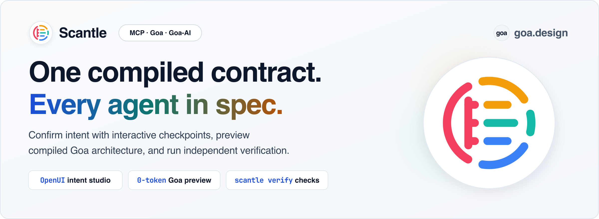

<p align="center">
  <picture>
    <source media="(prefers-color-scheme: dark)" srcset="docs/img/scantle-banner-dark.png">
    
  </picture>
</p>

<p align="center">
  <a href="https://pkg.go.dev/github.com/goadesign/scantle"></a>
  <a href="https://modelcontextprotocol.io"></a>
  <a href="https://github.com/goadesign/scantle/blob/main/LICENSE"></a>
</p>

# Scantle

**An agentic software factory that builds, verifies, and evolves production services at a fraction of the token cost.**

Solo coding agents—and most multi-agent "team" wrappers—still ask LLMs to hand-write every line of HTTP routing, auth middleware, workflow plumbing, and tests from scratch. That works on day one and collapses by feature three: the codebase drifts into an inconsistent maze that burns more tokens on every edit, and the agent writing the code writes tests that rubber-stamp its own bugs.

**Scantle** pairs mixed-model agent teams (combining frontier reasoners and fast coding models across **Claude, Codex, and Gemini**) with a deterministic compiler stack. Because [Goa](https://github.com/goadesign/goa) generates transports, schemas, and validation at **0 LLM tokens**, and [Goa-AI](https://github.com/goadesign/goa-ai) provides built-in durable workflows, tool guardrails, and isolated evaluation, your agents only write compact contracts and pure domain logic, and a separate `scantle verify` step checks the candidate build in an OS sandbox before you merge.

```text
You: "Add a refund assistant to our orders service. Refunds up to $50 get
      instant store credit; anything larger waits for a manager."

Scantle: Before I propose a build plan, two quick edge cases:
  1. Does "$50" mean item subtotal, or total including tax and shipping?
  2. What happens at exactly $50.00 — instant credit or manager approval?

You: "Total including tax and shipping, and $50.00 is instant."

Scantle: Locked 5 acceptance checks, compiled design/orders.go (0 tokens),
         and proposed a team across model families & classes:
  • Architect (Claude Opus)     → API, auth & workflow contract
  • Builder (Claude Sonnet)     → Refund workflow & state store
  • Test Author (Gemini Pro)    → Isolated acceptance & crash suite
  • Reviewer (Codex)            → Adversarial security & code review
```

---

## Why Engineers Use Scantle

### 1. 0-token code generation—agents write the contract, the compiler writes the plumbing
Why pay an LLM to hallucinate 3,000 lines of HTTP handlers, gRPC stubs, OpenAPI specs, MCP schemas, and JSON validators? In Scantle, the Architect agent expresses your API, agent tools, and security rules in a compact, strongly typed design (`design/*.go`). Goa deterministically generates the transports, OpenAPI specs, MCP schemas, and validators from that design with no model inference (**0 LLM tokens**)—eliminating entire classes of glue-code bugs and the token spend of writing them by hand.

### 2. A built-in Golden Path that stays cheap and effortless to evolve
Most AI-built codebases rot after a few weeks because every prompt invents a new folder structure, a new way to call LLMs, or a new auth pattern—forcing future agents to burn tens of thousands of tokens just reverse-engineering the repo. Scantle enforces an embedded **Golden Path architecture**:
- **Predictable layout & generated agent maps:** Every service follows the same clean structure and ships an auto-generated `AGENTS_QUICKSTART.md` map, so any coding agent can jump in months later and extend the platform with minimal context tokens.
- **Production patterns by default:** One HTTP/MCP edge gateway, internal gRPC services, a central LLM gateway with rate limiting and cost tracking, durable Temporal workflows, and server-injected `tenant_id`/`user_id` fields that the LLM can never spoof.

### 3. Mixed-model teams where the builder never grades its own homework
When configured with provider profiles (`-swarm-profiles`) and explicit builder path scopes, Scantle proposes a team that routes each role to the right model family and class—frontier reasoning models for architecture and security review, fast coding models for scoped implementation, and a **disjoint model family** for test authoring. Final verification (`scantle verify`, built on `internal/verify`) runs inside an **OS sandbox** (`verify/candidate`) the builder cannot touch:
- **Unseen holdout tests:** Hidden scenarios verify security and edge cases while [`Report.ForBuilders()`](internal/verify/report.go) strips holdout names, inputs, and logs from the builder's view. For those scenarios to stay unseen, builders must not be able to read the evaluator suite or its report and work directories; share only the redacted builder report with them.
- **Real `kill -9` crash & budget proof:** The included [`examples/orders-eval`](examples/orders-eval/) reference suite (`scantle verify` or `go test -race -tags e2e`) kills the Temporal worker mid-transaction (`kill -9`), restarts the API during paused approvals, and fails any scenario whose runtime LLM token use exceeds its budget (`TestSeededPayloadBloatFailsTheBudget` proves it with a seeded payload bloat).

### 4. Fast draft overrides and live role-switched testing
Instead of reading a 2,000-line diff blindly, Scantle separates fast prompt tuning from compiled business rules and ships stateful dependency simulators in [`examples/orders-eval`](examples/orders-eval/):
- **Test across real auth boundaries:** In the reference platform, trigger a `\$54.00` refund as a **Customer**, verify that customer credentials cannot approve it (`403 Forbidden`), and switch to **Approving Manager** to approve or decline the paused workflow through the real HTTP API.
- **Iterate on prompts without rebuilding:** When a host binds `Options.TargetUpdater`, `draft_override` (`POST /sandbox/draft`) updates prompt wording in the target's `prompt.Store` in memory, without rebuilding Go code—while Scantle refuses any attempt to override compiled Go business rules (`target_kind: "compiled_rule"`, `requires_rebuild: true`; standalone `scantle serve` binds no `TargetUpdater`, so `prompt_template` overrides are rejected unless embedded).
- **Interactive MCP Apps checkpoint viewer (`ui://scantle/checkpoint`):** An MCP Apps host loads the viewer through MCP `resources/read` (`text/html;profile=mcp-app`) and shows each tool result in it. For a Change Card, the viewer shows a form with every open question, example, and preserved behavior, and saves through `confirm_intent` (recovering a newer saved card with `get_change`, without losing unsaved edits). When the CP1 model also composed a decision view, the viewer renders it with OpenUI components such as a policy simulator table, ambiguity choice cards, a workflow timeline, and impact callouts. Choices made there change the same draft the form submits, and the view is labeled as a model-proposed illustration. An invalid or stale composition leaves the full form usable. The viewer also renders architecture previews (a C4 graph above inspectable lists), structural diffs, and fast-draft results, keeping IDs and digests in expandable Details. The planned role-switcher and replay controls are described in [`docs/HOW_IT_WORKS.md`](docs/HOW_IT_WORKS.md#checkpoint-3-cp3-fast-draft-overrides--live-sandbox-walkthrough).

> **Why the name "Scantle"?** A *scantle* is a slater’s gauge rod, notched once so every slate on a roof is measured against the same hard edge. In Scantle, `design/*.go` is that gauge rod—one compiled contract every builder works to, and an independent verifier measures against.

---

## Try It in 60 Seconds

Start the Scantle control plane, connect your coding assistant, and watch it evolve or verify the included [`examples/orders`](examples/orders/README.md) reference platform:

```bash
# 1. Start the Scantle MCP & HTTP control plane with CP1 model analysis and multi-family swarm profiles
export SCANTLE_AUTH_TOKEN="dev-secret-token"
export ANTHROPIC_API_KEY="sk-ant-..."
go run ./cmd/scantle serve \
  -addr 127.0.0.1:8090 \
  -principal operator@example.com \
  -model-provider anthropic \
  -model-name claude-opus-4-6 \
  -swarm-profiles ./examples/orders/swarm-profiles.example.json
```

Point **Claude Code, Codex, Gemini, or Cursor** at `http://127.0.0.1:8090/mcp` (see [`.mcp.json` setup](docs/REFERENCE.md#quickstart--mcp-configuration) and [`-swarm-profiles` configuration](docs/REFERENCE.md#configure-the-proposed-swarm-roster); [`examples/orders/swarm-profiles.example.json`](examples/orders/swarm-profiles.example.json) is an illustrative operator-edited profile file where `"authenticated": true` is an operator assertion rather than a live credential check, and setting `ANTHROPIC_API_KEY` for CP1 analysis does not authenticate the OpenAI or Google coding-agent CLIs) and prompt your agent:

> *"Using Scantle, propose a change to `examples/orders` so VIP customers get instant store-credit refunds up to \$150, then preview the compiled C4 architecture and Chorus swarm plan for builder scope `orders` (`internal/**`)."*

Your agent will create the Change Card (`propose_change`, calling `confirm_intent` to answer open ambiguity questions or refine confirmed answers and examples), compile the candidate Goa contract at **0 LLM tokens** (`preview_architecture`), and return the updated C4 topology, tool guardrails, and a proposed cross-family team roster (`@architect`, `@builder-orders`, `@eval-author`, `@reviewer`). The preview proposes the team; it does not launch agents.

To run the full OS-sandboxed verification suite (and compare the full operator report with the builder-redacted `-builder-view` report where `"holdout"` scenarios are redacted to `"id": "holdout-1"`), see the **[Orders Reference Platform Walkthrough (`examples/orders/README.md`)](examples/orders/README.md)**.

---

## Dive Deeper

- **[Orders Reference Platform (`examples/orders/README.md`)](examples/orders/README.md)** — Walk through the Golden Path `orders` platform, run `scantle verify` (full vs. `-builder-view`), and watch `TestSeededPayloadBloatFailsTheBudget` catch a token regression.
- **[How Scantle Works (`docs/HOW_IT_WORKS.md`)](docs/HOW_IT_WORKS.md)** — Walk through the 5 checkpoints (`CP1`–`CP5`), the proposed cross-model team, fast draft overrides, and OS-isolated verification.
- **[Golden Path Architecture (`docs/ARCHITECTURE_PLAYBOOK.md`)](docs/ARCHITECTURE_PLAYBOOK.md)** — Explore the 7 Golden Path rules that keep Scantle platforms maintainable and see how the Goa Design suite powers them.
- **[CLI, MCP & Repo Reference (`docs/REFERENCE.md`)](docs/REFERENCE.md)** — Copy `.mcp.json` configuration, browse the MCP tools and CLI flags, and run the [`examples/orders`](examples/orders/) reference suite.
- **[Architecture Proposal (`PROPOSAL.md`)](PROPOSAL.md)** & **[Product Vision (`PRESS_RELEASE.md`)](PRESS_RELEASE.md)** — Read the full system design, threat model, and Working Backwards press release.

## License

Scantle is released under the [MIT License](LICENSE).
