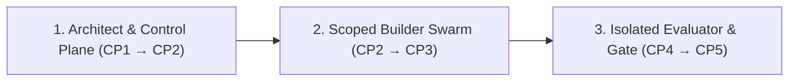

# How Surla Works: The 5 Checkpoints & Isolated Verification

**[← Back to README](../README.md)** · **[Golden Path Architecture →](ARCHITECTURE_PLAYBOOK.md)** · **[CLI & MCP Reference →](REFERENCE.md)**

Surla replaces blind trust in agent-generated diffs with a chain of evidence from **natural-language intent → compiled Goa contract → scoped multi-model construction → OS-isolated verification**.

When your request is already unambiguous, `propose_change` confirms the Change Card itself, so you can go straight to the Checkpoint 2 architecture preview.

---

## Overview: Three Roles, Strict Separation of Powers

Surla plans every change around three distinct roles so the agent that writes the code never defines the contract alone or grades its own output. Surla proposes the team; the builders themselves are your coding agents:



1. **📐 Architect & Control Plane (`CP1` → `CP2`) — Intent Lock, Compiled Contract & Swarm Plan**
   - Surfaces concrete input/outcome examples and open domain questions at `CP1`, freezing a SHA-256 `request_revision` digest once you confirm.
   - Evaluates `design/*.go` inside a sandboxed subprocess at `CP2` (`0` LLM tokens) to extract the C4 topology, tool schemas, and security guardrails, and—when server-configured provider profiles (`-swarm-profiles`) and explicit builder path scopes (`builders`) are supplied—proposes assigning `@architect`, `@builder-<scope>`, `@eval-author`, and `@reviewer` across distinct model families.
2. **🛠️ Scoped Builder Swarm (`CP2` → `CP3`) — Golden Path Implementation & Fast Draft Mode**
   - Builders read `surla://golden-path` and generated `AGENTS_QUICKSTART.md`. Because `goa gen` writes all HTTP/gRPC/MCP/OpenAPI plumbing, builders implement only domain and Temporal workflow packages within their owned paths.
   - In `CP3`, `draft_override` updates prompt templates in memory, without rebuilding Go code, through `Options.TargetUpdater` when an embedding host binds one, while refusing to override compiled Go business rules (`compiled_rule`). You can test **Customer** vs. **Approving Manager** flows against the candidate API and stateful simulators.
3. **🛡️ Isolated Evaluator & Gate (`CP4` → `CP5`) — Sandboxed Verification, Crash & Budget Proof**
   - `verify.Run` checks out exact `CandidateCommit` and `SuiteCommit` SHAs, builds the candidate binaries inside a macOS `sandbox-exec` jail (`candidate.Build`), and runs the trusted evaluator suite against them—exposed on the CLI as `surla verify` and on the control plane as `verify_change` (`POST /changes/{change_id}/verifications`) and `get_verification` (`GET /verifications/{run_id}`), which run each verification in a detached supervised process group (`internal/verifyrun`) that survives `surla serve` restarts. The suite starts each candidate process in its own sandbox (`candidate.Exec`); in the `examples/orders-eval` reference suite, candidate LLM calls also go through the evaluator's gRPC model gateway.
   - Redacts unseen **holdout scenarios** from builder reports (`Report.ForBuilders()`) and re-derives the report from raw evidence to verify `CandidateCommit`, `RequestRevision`, `SuiteID`, `SuiteCommit`, candidate binary `Artifacts` digests, and `Environment` in `verify.Approve`—exposed on the CLI as `surla approve` (which checks a saved report file against explicit flags without recording a card approval) and on the control plane as `approve_merge` (`POST /changes/approve`, which loads the report and current promotion inputs from `Options.PromotionTarget` and saves the recorded approval on `ChangeCardResult.approval` in `Options.CardsDir` for the card's bearer principal without merging or deploying).

---

## Checkpoint 1 (`CP1`): Confirm What Surla Understood

When you call `propose_change`, Surla analyzes your feature request against the current `design/*.go` using the embedded Golden Path system prompt (`goldenpath.ArchitectSystemPrompt`) and produces a structured **Change Card**:

```text
Surla · Here's What I Understood (change_id: req-refunds, status: needs_confirmation)
───────────────────────────────────────────────────────────────────────────────────────
Examples (each maps to an isolated evaluator check):
  ✓ req-refunds-check-01  $35 item ($38.50 total)     → Instant store credit, no approval [deterministic]
  ✓ req-refunds-check-02  $75 item ($82.00 total)     → Waits for manager approval        [deterministic]
  ✓ req-refunds-check-03  Manager declines $75 refund → Customer sees reason + support    [model_judged]

Open questions to settle before building:
  ? req-refunds-ambiguity-01  Does "under $50" mean item subtotal or total with tax & shipping?
                              (e.g., $48 item + $6 shipping = $54)
  ? req-refunds-ambiguity-02  What happens at exactly $50.00 — instant credit or manager approval?
```

- **Server-assigned IDs & strict schema validation**: The control plane validates structured model output with `DisallowUnknownFields`, assigns deterministic `<change_id>-ambiguity-NN` and `<change_id>-check-NN` IDs in Go code, and rejects malformed responses.
- **Durable on-disk Change Card store (`Options.CardsDir` / `-cards-dir`)**: `controlplane.New(opts)` opens `opts.CardsDir` (`surla serve -cards-dir`, default `.surla/cards`), acquires an exclusive non-blocking `flock` on `<cards_dir>/lock` held until `(*ControlPlane).Close()`, and saves each card (`card`, `owner`, `design_source`) as `<cards_dir>/<sha256(change_id)>.json` via a synced staging file, atomic rename, and directory `fsync`. Every read decodes the file with `DisallowUnknownFields`, rejects trailing tokens, and verifies that the card's `request_revision` matches `computeCanonicalRevision(card, owner, design_source)` so Change Cards survive `surla serve` restarts without an in-memory cache.
- **Revision lock & iterative refinement (`confirm_intent`, `get_change`, & `approve_merge`)**: Answering the open questions transitions the card to `confirmed` and computes a canonical SHA-256 `request_revision` digest. Calling `confirm_intent` again on a `confirmed` card with its current `request_revision` refines the locked answers or examples (returning the stored card on a no-op submit and minting a new `request_revision` when answers or examples change, which invalidates stale downstream previews, verification reports, and any recorded `approval`). If another editor updates the card first, `get_change` (`GET /changes/{change_id}`) fetches the latest saved `ChangeCardResult`. Whenever `get_change` or a no-op `confirm_intent` reads a card with a recorded `approval`, it omits `approval` on a shallow response copy when `Options.PromotionTarget` is nil (leaving the saved approval on disk intact), or checks `PromotionTarget.CurrentInputs` for `approval.candidate_commit`: it includes `approval` only when the current `SuiteID`, `SuiteCommit`, `Environment`, and `Artifacts` still match, omits `approval` on a shallow response copy when they differ (without mutating the saved card or `request_revision`), and returns an error if `CurrentInputs` fails. `preview_architecture` and `approve_merge` reject a `request_revision` that is not the card's current one. `surla verify` records the `-request-revision` you pass in its report, and `surla approve` (`verify.Approve`) compares a saved report file with the explicit binding flags its caller supplies without looking up a stored card.

---

## Checkpoint 2 (`CP2`): Review the Compiled Contract & Multi-Model Swarm

Calling `preview_architecture` against a confirmed Change Card stages the candidate `DesignSnapshot` inside an isolated subprocess, runs Goa, Goa-AI, and `goa.design/model` evaluation, and returns the bound architecture preview and proposed swarm plan (for local read-only design inspection without a Change Card, `request_revision`, `design_digest`, or `swarm` plan, run `surla preview -dir <module>` on the CLI to print the raw `designeval.Result`):

```text
Surla · Contract & Build Plan (Request rev #2, Design digest sha256:4f8a...)
───────────────────────────────────────────────────────────────────────────────────────
Scope:    1 edge service (orders), 2 internal services (commerce, payments), 1 agent (refund)
Contract: orders.issue_store_credit & orders.request_refund
          • tenant_id & customer_id injected server-side (omitted from LLM schema)
          • BoundedResult pagination on orders.list_orders & orders.continue_orders
          • Design-time Confirmation gate on orders.request_refund
Swarm:    @architect (Claude) · @builder-orders (Claude) · @eval-author (Gemini) · @reviewer (Codex)
          • cross_family_review: true · cross_family_eval: true
```

### How Cross-Family Chorus Routing Works (`internal/swarm`)
When coding-agent provider profiles are configured on the server (`Options.SwarmProfiles` / `-swarm-profiles`) and the caller supplies explicit `builders` path scopes, Surla's planner (`swarm.Plan`) deterministically assigns roles:
1. **Explicit Builder Scopes**: Each builder (`@builder-<scope>`) receives explicit repository-relative path globs (such as `internal/**`) with `read_write_worktree` access required of the job runner. If `builders` or `SwarmProfiles` are omitted, `swarm.Plan` returns `status: "unconfigured"` rather than guessing repository paths or probing host binaries.
2. **Disjoint Reviewer & Eval-Author Families**: Surla resolves pinned builders first and scores candidate default model families against the union of pinned and unpinned builder families so `@reviewer` (`read_only_review`) and `@eval-author` (`isolated_eval_workspace`) use model families disjoint from every builder whenever configured profiles (`Authenticated: true`) allow.
3. **Honest Posture Reporting**: If only one model family is configured—or if pinned builders span all available families—Surla reports `cross_family_review: false` or `single_family: true` rather than claiming cross-family diversity that did not happen.
4. **Chorus Collaboration Manifest**: `swarm.FormatManifest` emits a compact manifest (change and design digest, cross-family status, and each role's handle, profile, model, family, access mode, and owned paths) that an orchestrator can pin in a [Chorus](https://github.com/goadesign/chorus) channel. Surla returns it; it does not publish it.

---

## Checkpoint 3 (`CP3`): Fast Draft Overrides & Live Sandbox Walkthrough

At `CP3`, Surla separates in-memory prompt tuning from compiled business rules and pairs the candidate service with stateful dependency simulators (`examples/orders-eval/sim`).

> **Current implementation vs. target CP3 UI:** Today, `internal/controlplane` serves the `draft_override` MCP tool (`POST /sandbox/draft`), which applies `prompt_template` updates when an embedding host binds `Options.TargetUpdater` and rejects them on standalone `surla serve`. It also serves the stateless `ui://surla/checkpoint` MCP Apps viewer through MCP `resources/read` (`POST /mcp`; `GET /ui/checkpoint` returns the HTML document as a JSON-encoded string). The viewer completes the `ui/initialize` → `ui/notifications/initialized` handshake with its host and renders each tool result: the CP1 Change Card form (`confirm_intent` and `get_change` through host `tools/call`), the optional CP1 OpenUI decision view, CP2 architecture previews (a keyboard-focusable scrollable C4 graph region above inspectable lists and an expandable `#surla-cp2-swarm-manifest` Chorus manifest), structural diffs, CP3 draft results, and CP4 verification runs (`verify_change` and `get_verification` with a `Check status` action and `aria-busy="true"` on `#surla-cp4-verification` while a status read is in flight). Role-switched Customer vs. Approving Manager flows run directly against the candidate HTTP API in [`examples/orders`](../examples/orders/README.md) and [`examples/orders-eval`](../examples/orders-eval/). The role-switcher dropdown, one-click scenario replay buttons, `+ Make This an Example` capture, and `openui.v1` action dispatch shown below are the target CP3 design (`PROPOSAL.md` §5.3), not shipped controls.

```text
Surla Sandbox · Candidate 3a506f6 · [ENV: SIMULATED PAYMENTS — NO REAL MONEY MOVES]
Role: [Customer ▾] (Switch to [Approving Manager] to approve/decline paused refunds)
───────────────────────────────────────────────────────────────────────────────────────
One-click replay of your confirmed examples:
  [▶ Replay: $48 + $6 shipping ($54) → Waits for manager]
  [▶ Replay: $50.00 total            → Instant store credit]
  [▶ Replay: $75 declined by manager → Customer explanation]
Or type any prompt to poke the agent live...        [+ Make This an Example] [⚡ Draft Tweak]
```

- **Role Switching Against Real Auth Boundaries**: Trigger a `\$54.00` refund as a **Customer**, verify that a `Customer` bearer token receives `403 Forbidden` if it calls the manager approval endpoint (`POST /runs/{run_id}/approval`), and switch to **Approving Manager** to approve or decline the paused workflow run via the public API.
- **CP1 Decision Studio (`ui://surla/checkpoint`)**: All nine Surla tools declare `ToolUI("ui://surla/checkpoint")`. When `propose_change` returns a `ui_composition`, the viewer renders it with the OpenUI decision catalog (`DecisionWorkspace`, `PolicySimulatorTable`, `PolicySimulatorRow`, `AmbiguityChoiceCard`, `WorkflowTimeline`, `WorkflowStep`, `ImpactCallout`). Its choice controls edit the same CP1 draft (`CP1DraftContext`) as the form. The workspace carries a `Model-Proposed Illustration` badge and a notice when you edit examples locally. When a new Change Card arrives while you have unsaved edits, switching to the incoming card (`#surla-replace-incoming-card`) preserves your earlier unsaved edits in `#surla-preserved-draft` alongside the new card. When a confirmed card carries a recorded `approval` from `approve_merge`, the viewer renders the `#surla-cp5-approval` panel describing that recorded check on the saved Change Card (with full commit, report, suite, and binary SHA-256 digests under expandable `Verified inputs and digests` details), warns when unsaved draft edits would mint a new `request_revision` and clear that approval, and refreshes any retained editor card via `get_change` after an applied `CP3` override without losing unsaved draft edits. `validateCompletedOpenUI` rejects compositions for another revision, components in the wrong slot, and props outside the catalog schemas, and the full form stays usable when it does. The published `@openuidev/lang-core@1.0.2` parser still silently skips bare lines and same-line trailing tokens; `validateCompletedOpenUI` already rejects programs whose `meta.discarded` is non-empty, which takes effect once a release with [thesysdev/openui#1525](https://github.com/thesysdev/openui/pull/1525) is selected.
- **Fast Draft Mode (`draft_override`)**:
  - Editing a **prompt template** (`target_kind: "prompt_template"`) invokes `Options.TargetUpdater` (when bound by an embedding host; rejected on standalone `surla serve`) to update the target platform's `prompt.Store` in memory, without rebuilding Go code, and returns the new `prompt_version` digest. On the target side, [`examples/orders`](../examples/orders/) wires a process-owned `prompt.NewInMemoryStore()` via `runtime.WithPromptStore` and exposes `override_prompt` (`PUT /prompts/{prompt_id}`, requiring the `prompts:manage` JWT scope): it validates the template before saving it, returns the accepted text's `sha256:...` version (`prompt.VersionFromTemplate`), and applies it on the next turn planned by that `orders` process (while a newly started `orders` process begins with the built-in `"v1"` prompt and other running `orders` processes keep their own prompts). Standalone `surla serve` still leaves `Options.TargetUpdater` unbound and rejects `prompt_template` edits; [`examples/orders/cmd/orders-surla`](../examples/orders/cmd/orders-surla/main.go) provides a separate reference `CP3` host (consuming the pinned `github.com/goadesign/surla` version in `examples/orders/go.mod`, saving cards in `-cards-dir`, default `.surla/orders-surla-cards`, with `SURLA_AUTH_TOKEN` authenticating MCP callers and `ORDERS_PROMPTS_TOKEN` granting `prompts:manage` on the target) that binds `TargetUpdater` to `override_prompt` while leaving `CP1` analysis, `CP4` verification, and `CP5` promotion unconfigured.
  - Attempting to override a **compiled business rule** (`target_kind: "compiled_rule"`, such as the `\$50.00` limit) is rejected (`requires_rebuild: true`) so hard domain invariants never drift into unverified prompt text.

---

## Checkpoints 4 & 5 (`CP4` & `CP5`): OS-Isolated Verification & Merge Gate

When verification runs via `surla verify` on the CLI or `verify_change` (`POST /changes/{change_id}/verifications`) and `get_verification` (`GET /verifications/{run_id}`) over MCP/HTTP (`internal/verify` `verify.Run` and `internal/verifyrun`, exercised end-to-end by `go test -race -tags e2e ./internal/verify` and `(cd examples/orders-eval && go test -race -tags e2e ./acceptance)`), Surla never trusts the builder's working directory or test output:

```text
Surla Evaluator Report · Candidate 3a506f6 (OS Sandbox: macOS sandbox-exec)
───────────────────────────────────────────────────────────────────────────────────────
Status: passed (5/5 scenarios passed · 1 unseen holdout scenario verified)

Confirmed Examples & Resilience Checks:
  ✓ store_credit_within_limit              $38.50 total → store credit, no manager
  ✓ card_refund_needs_manager              $54.00 total → waits; only that tenant's manager approves → 1 card refund
  ✓ refund_survives_worker_crash           worker killed (kill -9) after payment → 1 refund on replay
  ✓ pending_approval_survives_api_restart  API killed and restarted while waiting → approval → 1 card refund
  ✓ other_customers_order_refused          [HOLDOUT] another customer's order → no refund

Token & Cost Gate (via Evaluator Model Gateway):
  ✓ Measured usage within scenario budgets · 0 incomplete usage records
```

### Why the Builder Cannot Game the Evaluator
1. **OS Process & Filesystem Sandbox (`verify/candidate` & `verify/suite`)**: On macOS, candidate builds (`candidate.Build`, run by `verify.Run`) and candidate server/worker processes (`candidate.Exec`, started by the evaluator suite after `suite.Main` pins each `--artifact` binary with `candidate.Pin`) run under a strict `sandbox-exec` Seatbelt profile. They can write only to their temporary build/state directories and bind or connect only to evaluator-assigned `127.0.0.1` ports, and each scenario attaches `pinned.Evidence("<name>")` so the verifier can compare the suite-reported binary digests with the bound digests (actual process execution remains the trusted evaluator suite's responsibility).
2. **Evaluator-Owned Contracts & Simulators**: In the [`examples/orders-eval`](../examples/orders-eval/) reference suite, the evaluator binary is compiled from its own commit (`SuiteCommit`) with its own copy of the generated contracts and stateful commerce/payment simulators.
3. **Gateway-Enforced Token & Cost Accounting**: Every LLM call the candidate makes in `examples/orders-eval` traverses a `goa-ai` gRPC model gateway hosted by the evaluator. If a change bloats tool payloads (`TestSeededPayloadBloatFailsTheBudget`, raising an order page from `10` to `50` items) or makes a call whose usage the gateway cannot fully account for (counted in the evaluator's `Usage.Unreported`), the scenario fails even if functional assertions pass.
4. **Redacted Holdout View (`Report.ForBuilders()`)**: Builders receive a `BuilderReport` (`Report.ForBuilders()`) showing only anonymous holdout outcomes (`holdout-1`)—never the holdout scenario names, declarations, checks, or failure logs.
5. **Merge-Gate Check (`verify.Approve`, `surla approve`, and `approve_merge`)**: `verify.Approve` re-derives the entire `verify.Report` from its `Binding`, `Suite`, and raw `eval.Report` `Evidence` and verifies that `CandidateCommit`, `RequestRevision`, `SuiteID`, `SuiteCommit`, candidate binary `Artifacts` SHA-256 digests, and `Environment` match the change being promoted before approving. On the CLI, `surla approve` decodes a saved report file (`verify.DecodeReport`) and checks it against explicit promotion flags, printing a JSON summary (`report_digest`, `binding`, `counts`) on success without contacting a server or saving card state. On the control plane, `approve_merge` (`POST /changes/approve`) loads the report by `report_digest` and the current `PromotionInputs` for `candidate_commit` from `controlplane.Options.PromotionTarget`, checks them with `verify.Approve` against the owner's confirmed `request_revision`, and saves the updated card with `approval` (`ChangeCardResult.approval`) in `Options.CardsDir` for the authenticated bearer principal (replacing any prior approval on that revision) without merging branches or deploying binaries (`surla serve -promotion-config <path.json>` binds a staged-release `PromotionTarget` that loads reports from `report_dir` and hashes each configured regular-file binary inside an atomically published `<release_dir>/<candidate_commit>/` directory through a single `os.OpenRoot` handle, approving those staged binaries for a fresh launch with the evaluator suite's fixed configuration without claiming anything about already running processes; omitting `-promotion-config` leaves `PromotionTarget` unbound and rejects `approve_merge`). Whenever `get_change` or a no-op `confirm_intent` reads a saved card with a recorded `approval`, it omits `approval` when `PromotionTarget` is nil or re-checks `PromotionTarget.CurrentInputs(ctx, approval.CandidateCommit)` (rehashing the staged binaries on `-promotion-config`) so stale approvals are omitted when the target's suite, environment, or staged binary digests change (leaving the saved card on disk unchanged), and an embedding host's `CurrentInputs` fails when a live target runs unverified runtime overrides outside the fixed-input precondition in [`internal/verify/report.go`](../internal/verify/report.go).
