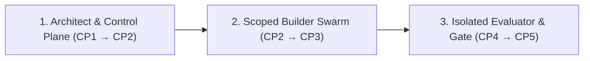

# How Scantle Works: The 5 Checkpoints & Isolated Verification

**[← Back to README](../README.md)** · **[Golden Path Architecture →](ARCHITECTURE_PLAYBOOK.md)** · **[CLI & MCP Reference →](REFERENCE.md)**

Scantle replaces blind trust in agent-generated diffs with an unbroken chain of evidence from **natural-language intent → compiled Goa contract → multi-model construction → live sandbox → OS-isolated verification**.

When your request is already unambiguous, Checkpoints 1 and 2 fold into a single approval step.

---

## Overview: Three Roles, Strict Separation of Powers

Scantle splits every change across three distinct roles so the agent that writes the code never defines the contract alone or grades its own output:



1. **📐 Architect & Control Plane (`CP1` → `CP2`) — Intent Lock, Compiled Contract & Swarm Plan**
   - Surfaces concrete input/outcome examples and open domain questions at `CP1`, freezing a SHA-256 `request_revision` digest once you confirm.
   - Evaluates `design/*.go` inside a sandboxed subprocess at `CP2` (`0` LLM tokens) to extract the C4 topology, tool schemas, and security guardrails, and—when server-configured provider profiles (`-swarm-profiles`) and explicit builder path scopes (`builders`) are supplied—assigns `@architect`, `@builder-<scope>`, `@eval-author`, and `@reviewer` across distinct model families.
2. **🛠️ Scoped Builder Swarm (`CP2` → `CP3`) — Golden Path Implementation & `0s` Draft Mode**
   - Builders read `scantle://golden-path` and generated `AGENTS_QUICKSTART.md`. Because `goa gen` writes all HTTP/gRPC/MCP/OpenAPI plumbing, builders implement only domain and Temporal workflow packages within their owned paths.
   - In `CP3`, `draft_override` hot-reloads prompt templates in **0 seconds** via `TargetPromptUpdater` while refusing to override compiled Go business rules (`compiled_rule`), and you can test **Customer** vs. **Approving Manager** flows against the candidate API and stateful simulators.
3. **🛡️ Isolated Evaluator & Gate (`CP4` → `CP5`) — Sandboxed Verification, Crash & Budget Proof**
   - Checks out exact `CandidateCommit` and `SuiteCommit` SHAs (`verify.Run`), compiles and runs candidate binaries inside a macOS `sandbox-exec` jail (`verify/candidate`), and routes candidate LLM calls through the evaluator's gRPC model gateway.
   - Redacts unseen **holdout scenarios** from builder reports (`Report.ForBuilders()`) and re-derives the report from raw evidence to verify `CandidateCommit`, `RequestRevision`, `SuiteID`, `SuiteCommit`, candidate binary `Artifacts` digests, and `Environment` in `verify.Approve`.

---

## Checkpoint 1 (`CP1`): Confirm What Scantle Understood

When you call `propose_change`, Scantle analyzes your feature request against the current `design/*.go` using the embedded Golden Path system prompt (`goldenpath.ArchitectSystemPrompt`) and produces a structured **Change Card**:

```text
Scantle · Here's What I Understood (change_id: req-refunds, status: needs_confirmation)
───────────────────────────────────────────────────────────────────────────────────────
Examples (each maps to an isolated evaluator check):
  ✓ req-refunds-check-01  $35 item ($38.50 total)     → Instant store credit, no approval [deterministic]
  ✓ req-refunds-check-02  $75 item ($82.00 total)     → Waits for manager approval        [deterministic]
  ✓ req-refunds-check-03  Manager declines $75 refund → Customer sees reason + support    [model_judged]

Open questions to settle before building:
  ? req-refunds-ambiguity-01  Does "under $50" mean item subtotal or total with tax & shipping?
                              (e.g., $48 item + $6 shipping = $54)
  ? req-refunds-ambiguity-02  What happens at exactly $50.00 — instant credit or manager approval?
```

- **Server-assigned IDs & strict schema validation**: The control plane validates structured model output with `DisallowUnknownFields`, assigns deterministic `<change_id>-ambiguity-NN` and `<change_id>-check-NN` IDs in Go code, and rejects malformed responses.
- **Immutable revision lock (`confirm_intent`)**: Answering the open questions transitions the card to `confirmed` and computes a canonical SHA-256 `request_revision` digest. Every downstream step (`CP2`–`CP5`) requires that exact revision.

---

## Checkpoint 2 (`CP2`): Review the Compiled Contract & Multi-Model Swarm

Calling `preview_architecture` stages the candidate `DesignSnapshot` inside an isolated subprocess, runs Goa, Goa-AI, and `goa.design/model` evaluation, and returns the verified architecture preview:

```text
Scantle · Contract & Build Plan (Request rev #2, Design digest sha256:4f8a...)
───────────────────────────────────────────────────────────────────────────────────────
Scope:    1 edge service (orders), 2 internal services (commerce, payments), 1 agent (refund)
Contract: orders.issue_store_credit & orders.request_refund
          • tenant_id & customer_id injected server-side (omitted from LLM schema)
          • BoundedResult pagination on orders.list_orders & orders.continue_orders
          • Design-time Confirmation gate on orders.request_refund
Swarm:    @architect (Claude) · @builder-orders (Claude) · @eval-author (Gemini) · @reviewer (Codex)
          • cross_family_review: true · cross_family_eval: true
```

### How Cross-Family Chorus Routing Works (`internal/swarm`)
When coding-agent provider profiles are configured on the server (`Options.SwarmProfiles` / `-swarm-profiles`) and the caller supplies explicit `builders` path scopes, Scantle's planner (`swarm.Plan`) deterministically assigns roles:
1. **Explicit Builder Scopes**: Each builder (`@builder-<scope>`) receives explicit repository-relative path globs (such as `internal/**`) with `read_write_worktree` access required of the job runner. If `builders` or `SwarmProfiles` are omitted, `swarm.Plan` returns `status: "unconfigured"` rather than guessing repository paths or probing host binaries.
2. **Disjoint Reviewer & Eval-Author Families**: Scantle resolves pinned builders first and scores candidate default model families against the union of pinned and unpinned builder families so `@reviewer` (`read_only_review`) and `@eval-author` (`isolated_eval_workspace`) use model families disjoint from every builder whenever configured profiles (`Authenticated: true`) allow.
3. **Honest Posture Reporting**: If only one model family is configured—or if pinned builders span all available families—Scantle reports `cross_family_review: false` or `single_family: true` rather than claiming cross-family diversity that did not happen.
4. **Chorus Collaboration Manifest**: `swarm.FormatManifest` emits a compact manifest ready for the orchestrator to publish to the [Chorus](https://github.com/goadesign/chorus) channel via `chorus.send(..., pin=true)` so every agent sees the exact owners, access modes, and verification command.

---

## Checkpoint 3 (`CP3`): Fast Draft Overrides & Live Sandbox Walkthrough

At `CP3`, Scantle separates 0-second prompt tuning from compiled business rules and pairs the candidate service with stateful dependency simulators (`examples/orders-eval/sim`).

> **Current implementation vs. target CP3 UI:** Today, `internal/controlplane` serves the `draft_override` MCP tool (`POST /sandbox/draft`, which applies `prompt_template` hot reloads when the host binds `Options.TargetUpdater` and rejects them on standalone `scantle serve` where `TargetUpdater` is unset) and the stateless `ui://scantle/checkpoint` (`text/html;profile=mcp-app`) MCP Apps viewer (`GET /ui/checkpoint`), which completes the `ui/initialize` → `ui/notifications/initialized` handshake with `window.parent` and renders validated CP1 `ChangeCardResult`, CP2 `ArchitecturePreviewResult`, and CP3 `DraftOverrideResult` payloads delivered via `ui/notifications/tool-result`. Role-switched Customer vs. Approving Manager flows run directly against the candidate HTTP API in [`examples/orders`](../examples/orders/README.md) and [`examples/orders-eval`](../examples/orders-eval/). The interactive role-switcher dropdown, one-click scenario replay buttons, `+ Make This an Example` capture, and `openui.v1` action dispatch shown below represent the target CP3 checkpoint web UI design (`PROPOSAL.md` §5.3).

```text
Scantle Sandbox · Candidate 3a506f6 · [ENV: SIMULATED PAYMENTS — NO REAL MONEY MOVES]
Role: [Customer ▾] (Switch to [Approving Manager] to approve/decline paused refunds)
───────────────────────────────────────────────────────────────────────────────────────
One-click replay of your confirmed examples:
  [▶ Replay: $48 + $6 shipping ($54) → Waits for manager]
  [▶ Replay: $50.00 total            → Instant store credit]
  [▶ Replay: $75 declined by manager → Customer explanation]
Or type any prompt to poke the agent live...        [+ Make This an Example] [⚡ Draft Tweak]
```

- **Role Switching Against Real Auth Boundaries**: Trigger a `\$54.00` refund as a **Customer**, verify that a `Customer` bearer token receives `403 Forbidden` if it calls the manager approval endpoint (`POST /orders/runs/{run_id}/approval`), and switch to **Approving Manager** to approve or decline the paused workflow run via the public API.
- **MCP Apps & Optional OpenUI Previews**: Tools that declare `ToolUI("ui://...")` pair structured `Result` and `ServerData` payloads with MCP Apps views (`ui://scantle/checkpoint`).
- **Fast Draft Mode (`draft_override`)**:
  - Editing a **prompt template** (`target_kind: "prompt_template"`) invokes `Options.TargetUpdater` (when bound by an embedding host; rejected on standalone `scantle serve`) to update the target platform's `prompt.Store` in **0 seconds** and returns the new `prompt_version` digest.
  - Attempting to override a **compiled business rule** (`target_kind: "compiled_rule"`, such as the `\$50.00` limit) is rejected (`requires_rebuild: true`) so hard domain invariants never drift into unverified prompt text.

---

## Checkpoints 4 & 5 (`CP4` & `CP5`): OS-Isolated Verification & Merge Gate

When verification runs via `scantle verify` (`internal/verify` `verify.Run` and `verify.Approve`, exercised end-to-end by `go test -race -tags e2e ./internal/verify` and `(cd examples/orders-eval && go test -race -tags e2e ./acceptance)`), Scantle never trusts the builder's working directory or test output:

```text
Scantle Evaluator Report · Candidate 3a506f6 (OS Sandbox: macOS sandbox-exec)
───────────────────────────────────────────────────────────────────────────────────────
Status: passed (5/5 scenarios passed · 1 unseen holdout scenario verified)

Confirmed Examples & Resilience Checks:
  ✓ store_credit_under_limit         $38.50 total → 1 payment write
  ✓ manager_approval_survives_api    $82.00 total → paused, API restarted, approved → 1 write
  ✓ refund_survives_worker_crash     worker killed (kill -9) after payment → 1 write on replay
  ✓ manager_decline_no_payment       $75.00 declined → polite explanation, 0 payment writes
  ✓ cross_customer_refund_refused    [HOLDOUT] cross-customer order access refused (0 writes)

Token & Cost Gate (via Evaluator Model Gateway):
  ✓ Measured usage within scenario budgets · 0 incomplete usage records
```

### Why the Builder Cannot Game the Evaluator
1. **OS Process & Filesystem Sandbox (`verify/candidate`)**: On macOS, candidate builds (`candidate.Build`) and candidate server/worker processes (`candidate.Start`) run under a strict `sandbox-exec` Seatbelt profile. They can write only to their temporary build/state directories and bind or connect only to evaluator-assigned `127.0.0.1` ports.
2. **Evaluator-Owned Contracts & Simulators**: In the [`examples/orders-eval`](../examples/orders-eval/) reference suite, the evaluator binary is compiled from its own commit (`SuiteCommit`) with its own copy of the generated contracts and stateful commerce/payment simulators.
3. **Gateway-Enforced Token & Cost Accounting**: Every LLM call the candidate makes in `examples/orders-eval` traverses a `goa-ai` gRPC model gateway hosted by the evaluator. If a change bloats tool payloads (`TestSeededPayloadBloatFailsTheBudget`, raising an order page from `10` to `50` items) or drops provider usage reporting (`RetainedUsageIncomplete`), the scenario fails even if functional assertions pass.
4. **Redacted Holdout View (`Report.ForBuilders()`)**: Builders receive a `BuilderReport` (`Report.ForBuilders()`) showing only anonymous holdout outcomes (`holdout-1`)—never the holdout scenario names, declarations, checks, or failure logs.
5. **Cryptographic Merge Approval (`verify.Approve`)**: Re-derives the entire `verify.Report` from its `Binding`, `Suite`, and raw `eval.Report` `Evidence` and verifies that `CandidateCommit`, `RequestRevision`, `SuiteID`, `SuiteCommit`, candidate binary `Artifacts` SHA-256 digests, and `Environment` match the change being promoted before approving. *(Binding runtime `prompt.Store` override versions into `verify.Binding` is a planned extension noted in [`internal/verify/report.go`](../internal/verify/report.go).)*
