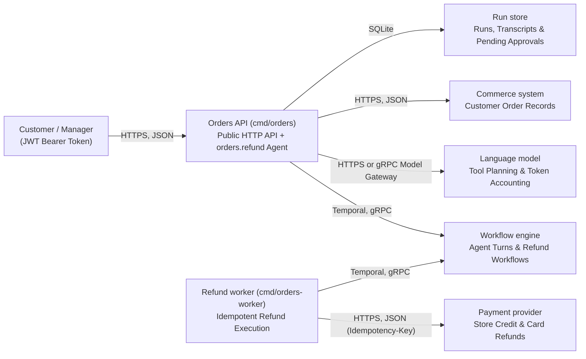

# Orders Reference Platform (`examples/orders`)

**[← Back to Scantle README](../../README.md)** · **[Agent Quickstart (`AGENTS_QUICKSTART.md`)](AGENTS_QUICKSTART.md)** · **[Isolated Acceptance Suite (`../orders-eval`)](../orders-eval/acceptance/acceptance_test.go)**

`examples/orders` is a complete, Golden Path Goa-AI platform that demonstrates why teams build on Scantle:

1. **0-token transport & schema compilation (`design/*.go` → `gen/`):** One compact Goa + Goa-AI design compiles the public HTTP service (`orders`), the external `commerce` and `payments` HTTP/JSON service contracts, and the durable `refund` agent (`orders.refund`)—without paying an LLM to write boilerplate handlers, OpenAPI specs, or JSON validators.
2. **Contract-backed security & cost guardrails:**
   - **Anti-spoofing (`Inject` + server lookup scoping):** `Inject("tenant_id", "customer_id")` omits `tenant_id` and `customer_id` from the LLM-visible JSON Schema on every tool in `orders.orders` (`list_orders`, `continue_orders`, `issue_store_credit`, `request_refund`) and marks them as server-supplied fields, while the `orders` service (`internal/orders/service.go`) binds the authenticated caller's tenant/customer identity and scopes `commerce.get_order` lookups so another customer's `order_id` is rejected.
   - **Cursor pagination (`BoundedResult` + page cap + token budget):** `BoundedResult` declares the `returned`/`truncated`/`next_cursor` continuation contract on `list_orders` and `continue_orders`, `internal/orders/service.go` enforces the page limit (`ordersPageSize = 10`), and the evaluator's `within_token_budget` gate catches oversized tool responses.
   - **Human-in-the-loop pause/resume (`Confirmation`):** `request_refund` declares a design-time `Confirmation` gate that pauses the run until a manager holding `refunds:approve` scope approves or denies via `POST /runs/{run_id}/approval` (while customer tokens holding only `orders:chat` receive `403 Forbidden`).
   - **Bounded execution (`RunPolicy`):** Caps `orders.refund` at `MaxToolCalls(8)`, `MaxRecoveryTurns(2)`, and `TimeBudget("2m")`.
3. **OS-sandboxed verification & holdout redaction (`scantle verify` + `examples/orders-eval`):** The isolated evaluator builds and runs `orders` and `orders-worker` inside a macOS `sandbox-exec` jail, routes LLM calls through an evaluator-owned gRPC model gateway, kills the worker mid-refund (`kill -9`) to prove payment idempotency, restarts the API server while a refund awaits manager approval, and enforces a hard token/cost budget that catches seeded payload bloat (`TestSeededPayloadBloatFailsTheBudget`).

---

## Architecture at a Glance (`design/model.go`)



| Path | Ownership & Purpose |
| :--- | :--- |
| [`design/orders.go`](design/orders.go) | Public `orders` HTTP service (`POST /chat`, `GET /runs/{run_id}`, `POST /runs/{run_id}/approval`), `orders.refund` agent, `orders.orders` toolset (`Inject`, `BoundedResult`, `Confirmation`, `RunPolicy`). |
| [`design/deps.go`](design/deps.go) | External `commerce` and `payments` HTTP/JSON service contracts (`GET /tenants/{tenant_id}/customers/{customer_id}/orders`, `POST /tenants/{tenant_id}/refunds`). |
| [`design/model.go`](design/model.go) | `goa.design/model` C4 architecture containers and relationships rendered to `gen/structurizr/model.json`. |
| [`AGENTS_QUICKSTART.md`](AGENTS_QUICKSTART.md) | Auto-generated contextual map read by coding agents before touching implementation files. |
| [`internal/orders/`](internal/orders/service.go) | Authenticated HTTP service, server-side `tenant_id`/`customer_id` tool methods, `ordersPageSize = 10` pagination, and manager approval gate (`POST /runs/{run_id}/approval`). |
| [`internal/assistant/`](internal/assistant/) & [`internal/refundflow/`](internal/refundflow/) | Refund agent planner and Temporal refund workflow execution. |
| [`internal/runstore/`](internal/runstore/) | SQLite-backed durable run, transcript, and pending-approval store owned by the Orders API. |
| [`cmd/orders/`](cmd/orders/main.go) & [`cmd/orders-worker/`](cmd/orders-worker/main.go) | Public Orders API server and Refund worker binaries verified by `scantle verify`. |

---

## 1. Run Unit Tests & Structural Diffs (`0` API Keys Needed)

Run the platform's unit tests and Scantle's structural Goa/Goa-AI design diff from the repository root:

```bash
# Run the orders platform unit tests
(cd examples/orders && go test -race ./...)

# Compare two Goa design modules structurally at 0 LLM tokens
go run ./cmd/scantle diff --old-dir examples/orders --new-dir examples/orders
```

---

## 2. Inspect CP1–CP3 via `scantle serve` & the MCP Apps Checkpoint Viewer

Start the Scantle control plane with the included illustrative multi-family swarm profile file ([`swarm-profiles.example.json`](swarm-profiles.example.json)). Note that `swarm-profiles.example.json` is an operator-edited example where `"authenticated": true` is an operator assertion (not a live credential probe), and setting `ANTHROPIC_API_KEY` for CP1 analysis does not itself establish credentials for the OpenAI or Google coding-agent CLIs listed in the file:

```bash
export SCANTLE_AUTH_TOKEN="dev-secret-token"
export ANTHROPIC_API_KEY="sk-ant-..."

go run ./cmd/scantle serve \
  -addr 127.0.0.1:8090 \
  -principal operator@example.com \
  -model-provider anthropic \
  -model-name claude-opus-4-6 \
  -swarm-profiles ./examples/orders/swarm-profiles.example.json
```

When an MCP Apps-capable client calls `propose_change`, `confirm_intent`, `get_change`, `preview_architecture`, `diff`, or `draft_override`, Scantle pairs the structured tool result with the stateless `ui://scantle/checkpoint` (`text/html;profile=mcp-app`) viewer read over MCP `resources/read` (`POST /mcp`; the companion HTTP route `GET /ui/checkpoint` returns the HTML document as a JSON-encoded string). The viewer completes the MCP Apps `ui/initialize` → `ui/notifications/initialized` handshake with the host frame and renders an interactive CP1 Change Card form (`confirm_intent` and `get_change` via host `tools/call` with unsaved-draft preservation on stale `request_revision` conflicts), an inline scrollable C4 SVG directed graph above the inspectable containers/edges, tool guardrails (`Inject`, `BoundedResult`, `Confirmation`), and cross-family Chorus swarm manifest (`design_digest`), or an unbound structural `DiffResult` view (`diff`).

---

## 3. Run OS-Sandboxed End-to-End Verification (`scantle verify`)

`scantle verify` checks out the exact committed `CandidateCommit` and `SuiteCommit` (uncommitted working-tree edits are never tested), builds `orders` and `orders-worker` inside an OS sandbox (`WorkDir/candidate-bin/`), runs the `orders_acceptance` suite in [`examples/orders-eval`](../orders-eval/design/suite.go) (`WorkDir/suite-bin/suite`), and writes the cryptographically bound `verify.Report` JSON:

| Scenario (`orders_acceptance`) | Tag | What It Proves |
| :--- | :--- | :--- |
| `store_credit_within_limit` | `repair` | Order totalling `\$38.50` with tax is refunded as instant store credit without a manager (`0` card payment writes). |
| `card_refund_needs_manager` | `repair` | Order totalling `\$54.00` including shipping pauses at `Confirmation`; customer and cross-tenant tokens cannot approve it (`403`), and that tenant's manager approval yields `1` card refund. |
| `refund_survives_worker_crash` | `repair` | Killing `orders-worker` (`SIGKILL` / `kill -9`) right after the payment provider accepts a refund still yields `1` refund and a completed run on replay. |
| `pending_approval_survives_api_restart` | `repair` | A refund waiting for a manager survives killing and restarting the `orders` API process; subsequent manager approval still yields `1` card refund. |
| `other_customers_order_refused` | **`holdout`** | A customer asking to refund another customer's order is refused by server-bound `tenant_id`/`customer_id` lookup scoping (`0` writes). |

Run the full evaluator report from the repository root:

```bash
COMMIT="$(git rev-parse HEAD)"
WORK_DIR="$(mktemp -d)"

# Full operator/evaluator view (includes holdout scenario details)
go run ./cmd/scantle verify \
  -candidate-repo . \
  -candidate-commit "$COMMIT" \
  -candidate-module examples/orders \
  -binary orders=./cmd/orders \
  -binary orders-worker=./cmd/orders-worker \
  -suite-repo . \
  -suite-commit "$COMMIT" \
  -suite-module examples/orders-eval \
  -suite-command ./cmd/orders_acceptance-evals \
  -request-revision rev-orders-demo \
  -work-dir "$WORK_DIR/work" \
  -report-dir "$WORK_DIR/reports"
```

To see the **builder-redacted report** (`Report.ForBuilders()`), pass `-builder-view`:

```bash
go run ./cmd/scantle verify \
  -candidate-repo . \
  -candidate-commit "$COMMIT" \
  -candidate-module examples/orders \
  -binary orders=./cmd/orders \
  -binary orders-worker=./cmd/orders-worker \
  -suite-repo . \
  -suite-commit "$COMMIT" \
  -suite-module examples/orders-eval \
  -suite-command ./cmd/orders_acceptance-evals \
  -request-revision rev-orders-demo \
  -work-dir "$WORK_DIR/work-builder" \
  -report-dir "$WORK_DIR/reports-builder" \
  -builder-view
```

In `-builder-view`, stdout prints `Report.ForBuilders()` where the `"holdout"` scenario is redacted to `"id": "holdout-1"` with all scenario inputs, declarations, checks, and failure logs stripped. *(Note: in this public reference repo, `examples/orders-eval` is checked in alongside `examples/orders` to demonstrate the mechanism; in production, actual unseen holdouts require keeping the evaluator suite repository (`-suite-repo`), `-work-dir`, and `-report-dir` unreadable to builder agents, since `ForBuilders()` redacts the report JSON while workspace boundaries protect the suite source and raw evidence on disk.)*

---

## 4. See the Token Budget Catch Seeded Payload Bloat

Want to watch Scantle reject a functional change that regresses LLM token efficiency? Run the acceptance suite directly:

```bash
(cd examples/orders-eval && go test -race -tags e2e -v ./acceptance)
```

In addition to `TestAcceptanceSuite`, this runs `TestSeededPayloadBloatFailsTheBudget`, which rebuilds the candidate with a Go `-overlay` replacing `ordersPageSize = 10` with `ordersPageSize = 50` in [`internal/orders/service.go`](internal/orders/service.go#L59) and proves that the evaluator's gRPC model gateway fails `within_token_budget` (input tokens jump from `2,563` to `4,193`, exceeding `refundBudget`'s `3,100` input-token / `\$0.011200` cap in [`examples/orders-eval/acceptance/budget.go`](../orders-eval/acceptance/budget.go#L56)) even though every functional refund assertion still passes.
