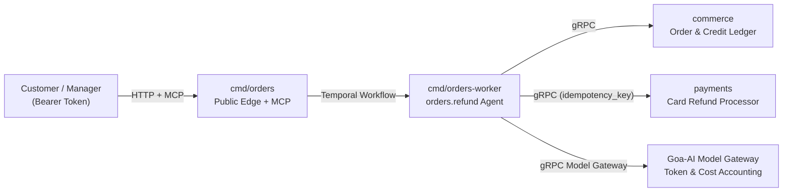

# Orders Reference Platform (`examples/orders`)

**[← Back to Scantle README](../../README.md)** · **[Agent Quickstart (`AGENTS_QUICKSTART.md`)](AGENTS_QUICKSTART.md)** · **[Isolated Acceptance Suite (`../orders-eval`)](../orders-eval/acceptance/acceptance_test.go)**

`examples/orders` is a complete, Golden Path Goa-AI platform that demonstrates why teams build on Scantle:

1. **0-token transport & schema compilation (`design/*.go` → `gen/`):** One compact Goa + Goa-AI design compiles the public HTTP & MCP edge service (`orders`), two internal gRPC services (`commerce` and `payments`), and the durable `refund` agent (`orders.refund`)—without paying an LLM to write boilerplate handlers, OpenAPI specs, or JSON validators.
2. **Compiler-enforced security & cost guardrails:**
   - **Anti-spoofing (`Inject`):** `tenant_id` and `customer_id` are injected server-side on every tool (`list_orders`, `continue_orders`, `get_order`, `issue_store_credit`, `request_refund`) and omitted from the LLM-visible JSON Schema so a prompt-injected model can never query or refund another customer's order.
   - **Cursor pagination (`BoundedResult`):** `list_orders` and `continue_orders` enforce a bounded page cursor (`next_cursor`) so tool responses never blow up the context window.
   - **Human-in-the-loop pause/resume (`Confirmation`):** `request_refund` declares a design-time `Confirmation` gate that pauses the Temporal workflow until an authenticated `approving_manager` approves or declines via `POST /orders/runs/{run_id}/approval` (while `customer` bearer tokens receive `403 Forbidden`).
   - **Bounded execution (`RunPolicy`):** Caps `orders.refund` at `MaxToolCalls(4)`, `MaxRecoveryTurns(1)`, and `TimeBudget("30s")` with prompt cache checkpoints (`AfterSystem`, `AfterTools`).
3. **OS-sandboxed verification & holdout redaction (`scantle verify` + `examples/orders-eval`):** The isolated evaluator builds and runs `orders` and `orders-worker` inside a macOS `sandbox-exec` jail, routes LLM calls through an evaluator-owned gRPC model gateway, kills the worker mid-refund (`kill -9`) to prove payment idempotency (`refund/<tenant>/<order>`), and enforces a hard token budget that catches seeded payload bloat (`TestSeededPayloadBloatFailsTheBudget`).

---

## Architecture at a Glance



| Path | Ownership & Purpose |
| :--- | :--- |
| [`design/orders.go`](design/orders.go) | Public `orders` HTTP + MCP service, `orders.refund` agent, `orders.tools` toolset (`Inject`, `BoundedResult`, `Confirmation`, `RunPolicy`). |
| [`design/deps.go`](design/deps.go) | Internal `commerce` and `payments` gRPC service contracts. |
| [`design/model.go`](design/model.go) | `goa.design/model` C4 architecture elements and relationships. |
| [`AGENTS_QUICKSTART.md`](AGENTS_QUICKSTART.md) | Auto-generated contextual map (`Quickstart()`) read by coding agents before touching implementation files. |
| [`internal/edge/`](internal/edge/) | Authenticated HTTP/MCP edge service and manager approval gate (`POST /orders/runs/{run_id}/approval`). |
| [`internal/refund/`](internal/refund/) | Refund workflow planner, tool executor, and server-side `tenant_id`/`customer_id` binder. |
| [`cmd/orders/`](cmd/orders/main.go) & [`cmd/orders-worker/`](cmd/orders-worker/main.go) | Public HTTP/MCP server and Temporal worker binaries verified by `scantle verify`. |

---

## 1. Run Unit Tests & Structural Diffs (`0` API Keys Needed)

Run the platform's unit tests and Scantle's structural Goa/Goa-AI design diff from the repository root:

```bash
# Run the orders platform unit tests
(cd examples/orders && go test -race ./...)

# Compare two Goa design modules structurally at 0 LLM tokens
go run ./cmd/scantle diff examples/orders examples/orders
```

---

## 2. Inspect CP1–CP3 via `scantle serve` & the MCP Apps Checkpoint Viewer

Start the Scantle control plane with the included multi-family swarm profile file ([`swarm-profiles.example.json`](swarm-profiles.example.json)):

```bash
export SCANTLE_AUTH_TOKEN="dev-secret-token"
export ANTHROPIC_API_KEY="sk-ant-..."

go run ./cmd/scantle serve \
  -addr 127.0.0.1:8090 \
  -principal operator@example.com \
  -model-provider anthropic \
  -model-name claude-opus-4-6 \
  -swarm-profiles ./examples/orders/swarm-profiles.example.json
```

When an MCP Apps-capable client calls `propose_change`, `confirm_intent`, `preview_architecture`, or `draft_override`, Scantle pairs the structured tool result with the stateless `ui://scantle/checkpoint` (`text/html;profile=mcp-app`) viewer (`GET /ui/checkpoint`). The viewer completes the MCP Apps `ui/initialize` → `ui/notifications/initialized` handshake with the host frame and renders the validated Change Card (`request_revision`), C4 containers/edges, tool guardrails (`Inject`, `BoundedResult`, `Confirmation`), and cross-family Chorus swarm manifest (`design_digest`).

---

## 3. Run OS-Sandboxed End-to-End Verification (`scantle verify`)

`scantle verify` checks out the exact `CandidateCommit` and `SuiteCommit`, builds `orders` and `orders-worker` inside an OS sandbox (`WorkDir/candidate-bin/`), runs the 5 acceptance scenarios in [`examples/orders-eval`](../orders-eval/acceptance/acceptance_test.go) (`WorkDir/suite-bin/suite`), and writes the cryptographically bound `verify.Report` JSON:

| Scenario | Kind | What It Proves |
| :--- | :--- | :--- |
| `store_credit_within_limit` | Visible | Instant store-credit refund (`<= $50.00`) executes in 1 turn with `0` card payment writes. |
| `card_refund_needs_manager` | Visible | Card refund pauses at `Confirmation`, survives an API server restart, rejects customer self-approval (`403`), and executes once when an `approving_manager` approves. |
| `refund_survives_worker_crash` | Visible | Temporal worker is killed with `SIGKILL` (`kill -9`) immediately after the payment RPC; replacement worker replays and completes with exactly `1` payment write (`refund/<tenant>/<order>`). |
| `manager_denies_refund` | Visible | Manager denial resumes the paused workflow with the declared `DeniedResultTemplate` (`0` payment writes) and returns a polite customer explanation. |
| `other_customers_order_refused` | **Holdout** | Cross-customer refund attempt is refused by server-injected `tenant_id`/`customer_id` scoping (`0` writes). |

Run the full evaluator report from the repository root:

```bash
COMMIT="$(git rev-parse HEAD)"
WORK_DIR="$(mktemp -d)"

# Full operator/evaluator view (includes holdout scenario details)
go run ./cmd/scantle verify \
  -repo . \
  -candidate-commit "$COMMIT" \
  -candidate-module examples/orders \
  -binary orders=./cmd/orders \
  -binary orders-worker=./cmd/orders-worker \
  -request-revision rev-orders-demo \
  -suite-id orders-acceptance \
  -suite-commit "$COMMIT" \
  -suite-module examples/orders-eval \
  -suite-pkg ./cmd/orders-eval-suite \
  -work-dir "$WORK_DIR/work" \
  -report-dir "$WORK_DIR/reports"
```

To see the **builder-redacted report** (`Report.ForBuilders()`), pass `-builder-view`:

```bash
go run ./cmd/scantle verify \
  -repo . \
  -candidate-commit "$COMMIT" \
  -candidate-module examples/orders \
  -binary orders=./cmd/orders \
  -binary orders-worker=./cmd/orders-worker \
  -request-revision rev-orders-demo \
  -suite-id orders-acceptance \
  -suite-commit "$COMMIT" \
  -suite-module examples/orders-eval \
  -suite-pkg ./cmd/orders-eval-suite \
  -work-dir "$WORK_DIR/work-builder" \
  -report-dir "$WORK_DIR/reports-builder" \
  -builder-view
```

In `-builder-view`, stdout prints `Report.ForBuilders()` where the unseen holdout scenario is redacted to `"name": "holdout-1"` with all scenario inputs, declarations, checks, and failure logs stripped. *(Note: `-work-dir` and `-report-dir` always store the full evaluator evidence and unredacted report on disk, so those directories must remain private to the evaluator.)*

---

## 4. See the Token Budget Catch Seeded Payload Bloat

Want to watch Scantle reject a functional change that regresses LLM token efficiency? Run the acceptance suite directly:

```bash
(cd examples/orders-eval && go test -race -tags e2e -v ./acceptance)
```

In addition to `TestAcceptanceSuite`, this runs `TestSeededPayloadBloatFailsTheBudget`, which clones `examples/orders`, mutates `ordersPageSize` from `10` to `50` in `internal/refund/tools.go`, rebuilds the candidate in the OS sandbox, and proves that the evaluator's gRPC model gateway fails the scenario (`MaxTotalTokens: 1100` exceeded) even though every functional refund assertion still passes.
